<p align="center">
  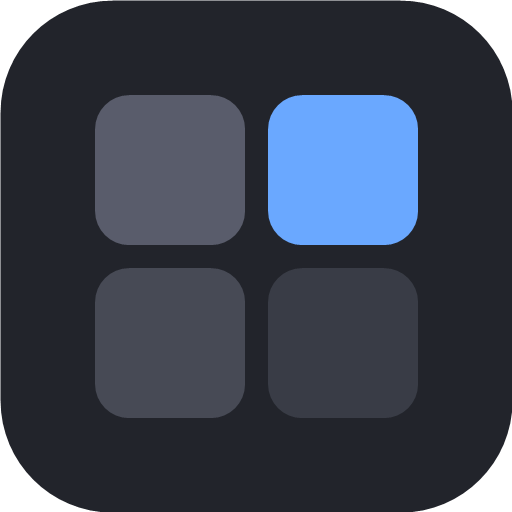
</p>

<h1 align="center">Tessera</h1>

<p align="center">
  <strong>The desktop IDE for working with AI agents: your projects, your Claude Code and Codex accounts, and your development tools, in one window.</strong>
</p>

<p align="center">
  <a href="https://github.com/NRVH/tessera/releases/latest"></a>
  <a href="./LICENSE"></a>
  
</p>

<p align="center">
  <a href="#download"><strong>Download</strong></a> · <a href="./README.md">Leer en español</a>
</p>

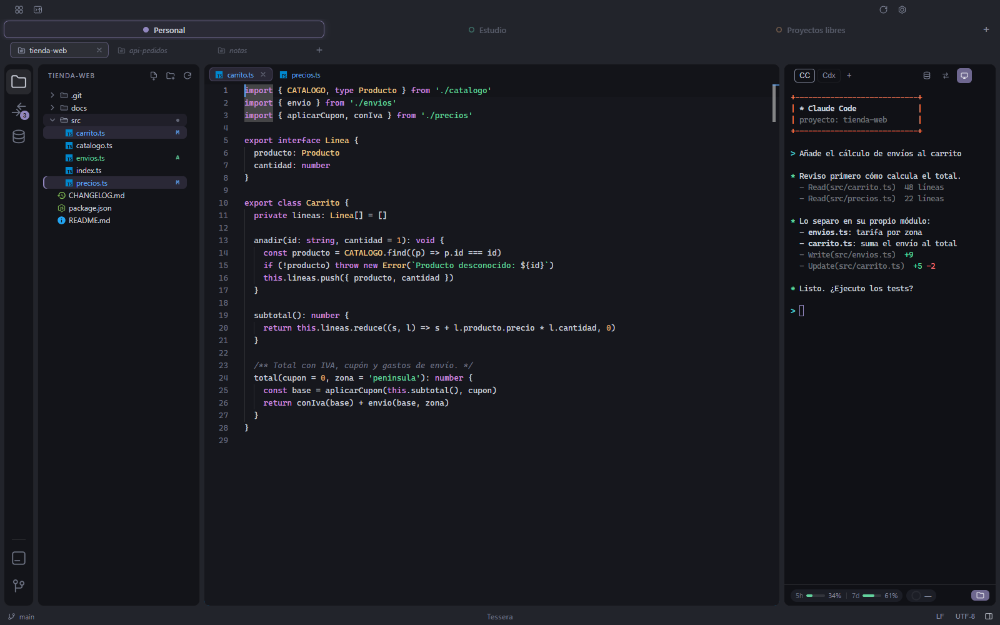

## What Tessera offers

- **As many accounts as your computer can handle.** Each agent uses the account signed in on your
  computer or an isolated account in Docker. You can create several Docker accounts of Claude Code
  and Codex and run them at the same time. Tessera sets no fixed maximum: it recommends a limit
  based on Docker's memory, and you can change it.
- **Your work continues when you switch accounts or agents.** Moving to another account of the
  same agent (Claude Code to Claude Code, or Codex to Codex) brings the whole conversation. Moving
  between Claude Code and Codex brings a summary of the latest messages and the Git status.
- **You decide how far each agent can reach.** In Docker, an agent sees only the projects it works
  on. It uses databases and SSH servers by name, without receiving the passwords.
- **You write instructions once.** Profile rules reach the Claude Code and Codex agents of that
  profile, in any project and with any account. An agent can propose changes, but only you accept
  them.
- **Everything in one place.** Editor, file explorer, Git, terminals, SSH connections and databases
  next to the agents, a grid to follow up to six agents at once, and a built-in guide, Tessera
  Academy.

> **Language note.** The interface and Tessera Academy are available in English and Spanish. The
> source code, commit messages and release notes are in Spanish, and issues and pull requests are
> welcome in either language.

## Contents

- [Several accounts at the same time](#several-accounts-at-the-same-time)
- [Continue in another account or agent](#continue-in-another-account-or-agent)
- [Download](#download)
- [Requirements](#requirements)
- [Getting started](#getting-started)
- [Features](#features)
- [Keyboard shortcuts](#keyboard-shortcuts)
- [Where your data lives](#where-your-data-lives)
- [Privacy](#privacy)
- [Building from source](#building-from-source)
- [Architecture](#architecture)
- [Contributing](#contributing)
- [License](#license)
- [Author](#author)

## Several accounts at the same time

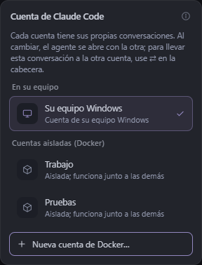

Tessera organizes your work into **profiles**. Each profile has its color, its projects and its
accounts. Each agent chooses its account from the button in its header, and Tessera remembers the
choice per agent and project:

- **The account on your computer** (native agent) is the session already signed in to Claude Code
  or Codex. It is the default and it is the same in every profile.
- **A Docker account** (isolated account) is an independent session that belongs to one agent in
  one profile. Each one runs in its own container, with its own history and usage limits, so two
  accounts of the same agent can work at the same time without interfering.

How many depends on your computer. As a guide, Tessera recommends 3 simultaneous containers with
8 GB of memory for Docker, 7 with 16 GB and 14 with 32 GB. A traffic light shows whether the value
you choose is comfortable, tight or excessive, and there is also a **No limit** option.

<br clear="right">

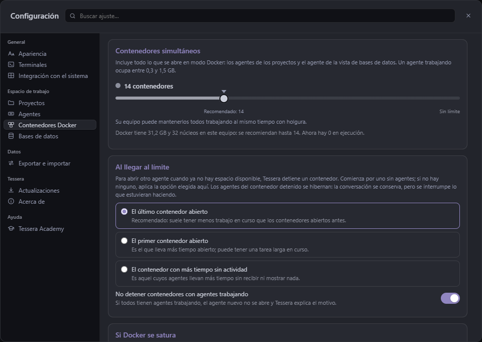

When the limit is reached, Tessera first stops a container with no agents and, if there is none,
the one set by the option you chose. If Docker's memory is saturated, it warns you before stopping
an agent and lets you choose another. The conversation is kept and resumes when you return.

## Continue in another account or agent

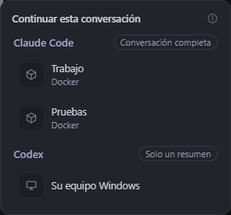

The **⇄** button in the agent header brings both options together:

| Destination | What moves | How it continues |
| --- | --- | --- |
| **Another account of the same agent**, in Docker or on your computer | The whole conversation | The agent resumes it in that account |
| **The other agent**, Claude Code to Codex or the other way around | A summary: the latest text messages and the Git status | A new conversation that reads the summary and waits for your instructions |

The original conversation does not change. Continuing in another account creates a copy: what you
write in one does not appear in the other. Custom agents do not have this option.

<br clear="right">

## Download

| Platform | Direct download (latest version) | Supported systems |
| --- | --- | --- |
| Windows | **[Download for Windows](https://github.com/NRVH/tessera/releases/latest/download/Tessera-Setup.exe)** (`.exe`) | Windows 11 (64-bit) |
| macOS | **[Download for Mac](https://github.com/NRVH/tessera/releases/latest/download/Tessera-mac-arm64.dmg)** (`.dmg`) | macOS 12 Monterey or later, **Apple Silicon only** (M1 and later) |
| Linux | **[Download for Linux](https://github.com/NRVH/tessera/releases/latest/download/Tessera-linux-x86_64.AppImage)** (`.AppImage`) | 64-bit (x86-64) desktop distributions with FUSE (`libfuse2`) |

Release notes and earlier installers are on
**[Releases](https://github.com/NRVH/tessera/releases)**.

The Windows installer is per user: it does not ask for administrator permissions and lets you choose
the installation folder. On macOS, open the `.dmg` and drag Tessera to **Applications**. On Linux,
make the AppImage executable (`chmod +x Tessera-linux-x86_64.AppImage`) and open it.

Tessera updates itself on all three platforms: it downloads the new version in the background and
applies it when it closes. You can change this in **Settings › Updates**.

### First launch of an app without a paid signature

Tessera is an independent open-source project and is not signed with a paid certificate, so Windows
and macOS show a warning the first time you open it.

- **Windows.** SmartScreen shows "Windows protected your PC". Click **More info** and then **Run
  anyway**.
- **macOS 15 Sequoia and later.** The first launch is blocked. Open **System Settings › Privacy &
  Security**, scroll to the notice about Tessera, click **Open Anyway** and confirm.
- **macOS 12 to 14.** Right-click (or Control-click) Tessera in Applications, choose **Open** and
  confirm.
- **Any macOS version, from the terminal:**

  ```bash
  xattr -dr com.apple.quarantine /Applications/Tessera.app
  ```

You only need to do this once: Tessera downloads its own updates and this warning does not appear
again. You can also [build Tessera from source](#building-from-source).

On macOS, the app is signed with Tessera's own certificate, the same in every version, so the
permissions you grant are kept across updates. The Keychain asks once after each update whether
Tessera can use its saved passwords: click **Always Allow**.

## Requirements

| What | When you need it |
| --- | --- |
| **Docker** | Only for Docker accounts: Docker Desktop on Windows (with the WSL 2 backend) and macOS, and the system Docker on Linux (rootless Docker is not supported). Tessera builds the container image the first time it is needed. |
| **Claude Code** and **Codex** | For native agents, at least one, installed on your computer and signed in. In Docker, both are included in the image. Each account needs its own subscription with the provider. |
| **Git** | For the Git view. On macOS it comes with the Xcode Command Line Tools. |
| **OpenSSH client** | For SSH connections. On Windows it is the optional "OpenSSH Client" feature, installed by default; if it is missing, Tessera uses the one from Git and tells you. On macOS and most Linux distributions it comes with the system. |
| **GNOME Keyring or KWallet** | Linux only, to save passwords. Without them, connections are still created, but Tessera does not save their passwords. |
| **Memory** | Tessera uses 400 to 800 MB, and each open agent uses 0.3 to 1.5 GB depending on its MCP servers. When memory runs low, Tessera hibernates idle native agents sooner and tells you. |
| **Java** (optional) | To decompile `.class` files. Tessera includes two engines: CFR (Java 6 or later) and Vineflower (Java 17 or later). |

## Getting started

1. **Open Tessera.** A new installation starts with the **Personal** profile. To create another,
   click the **+** at the end of the profile bar. Right-clicking a profile lets you rename it, change
   its color, write its rules, hibernate it or delete it.
2. **Add a project** with the **+** in the project bar and choose its folder. It can be one repository
   or a folder that contains several.
3. **Choose the agent's account** with the account button in its header: the one on your computer or
   an isolated Docker account. To create one, choose **New Docker account…**.
4. **Sign in.** In a new Docker account, the agent panel offers **Sign in**. A native agent uses the
   session already signed in on your computer.

Inside the app, **Settings › Tessera Academy** explains each feature step by step, in English and
Spanish. The **ⓘ** button in dialogs opens the matching section.

## Features

### Profiles and projects

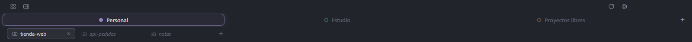

- Two levels of tabs: profiles on top, each with its color, and the open projects of that profile
  below. Drag them to reorder.
- **Profiles in a compact selector** (Settings › Appearance): replaces the profile bar with a selector
  in the title bar.
- Tessera restores each profile's open projects without starting every agent at once: an agent starts
  when you enter its project.
- **Hibernating a profile** stops its containers and frees their memory; it resumes when you return.
- **Idle native agents hibernate** after a few minutes (5 by default, or never) and resume their
  conversation when you return. This does not happen while the agent is working, waiting for a reply,
  or has unsent text.

### Agents

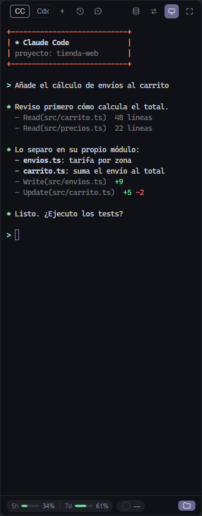

- **Claude Code and Codex** in every project, in a real terminal.
- **Conversation history** per project and account: resume or delete conversations. Opening a project
  resumes its last conversation.
- **Account usage** in the agent footer, with your plan's limits, and how much of the **context window**
  the conversation uses.
- **Profile rules.** A text with your instructions (branches, what not to change, how to name commits)
  that agents receive when they start. With `tctx proponer`, an agent proposes a change and you review
  the difference before accepting it. You write them in **Rules for agents…**, in the profile menu.
- **Search what was said.** With `tctx buscar`, an agent retrieves what was discussed in the project's
  conversations. In Docker, it searches only its own account.
- **Agent windows.** A native agent in a separate window, with no profile or project, from **New agent
  window**.
- **Updating agents.** For native agents, a button checks for a new version, installs it and restarts the
  sessions that need it, each in its own conversation; it waits for sessions that are working or waiting
  for a reply. In Docker, **Update agents** rebuilds the image.
- **Images and files** can be pasted into the agent's terminal; in Docker they are copied into the
  container.
- **Any other terminal agent**, added by hand with its name, its command and where it runs. It has no
  history, account usage or automatic hibernation.

### Native or in Docker, per agent

| | Native | Docker |
| --- | --- | --- |
| **Account** | The one signed in on your computer, one per agent | The ones you create, per agent and profile, each in its container |
| **What it sees** | The same as you, with your permissions | The projects it works on, its own account and, read-only, your SSH keys |
| **Needs Docker** | No | Yes |
| **Good for** | Tools and VPNs on your computer | Keeping accounts apart and limiting what the agent sees |

An agent in Docker can change the projects mounted in its container and use the network; the rest of your
disk is out of its reach. It has `sudo` inside the container, with no extra Docker privileges, and what it
installs is lost when the container stops. To keep something, build it into the image from **Settings ›
Projects**. **Codex in Docker** requires choosing **Full Access** with `/permissions`, because its own sandbox
cannot start inside a container; Tessera does not turn that mode on for you.

The bottom terminal is always native. A native agent is not isolated: it has your permissions, as if you had
started it from a terminal.

### Agent mosaic

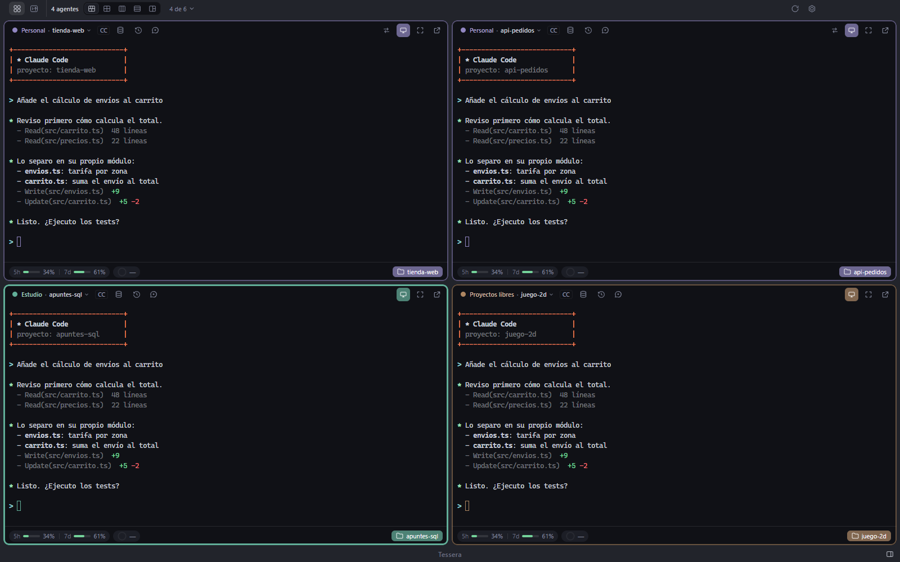

A grid with up to six visible agents, from any project and profile, including the terminal agent and the
database view agent. Jump to a tile, enlarge it, and leave with the same shortcut.

### Editor and viewers

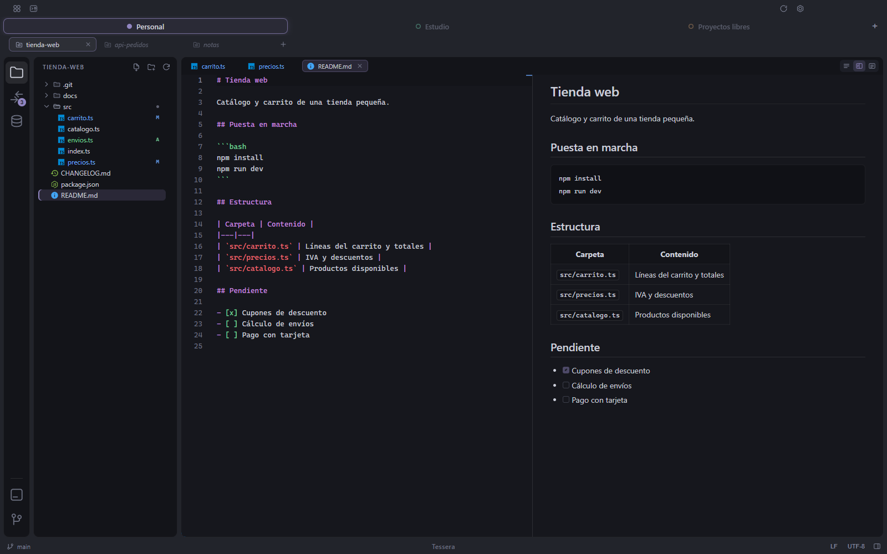

- **Monaco**, with syntax highlighting, find and replace, and tabs per project.
- **Encoding and line endings** of each file, shown in the status bar and convertible.
- **Markdown** with a rendered view (including Mermaid diagrams), a code view, or both with synchronized
  scrolling. HTML files have an isolated preview.
- **Viewers** for PDF, Word (`.docx`), ZIP, images, audio and video.
- **Java archives**: `.jar`, `.war`, `.ear` and `.aar` open as folders and `.class` files are decompiled when
  opened, also when comparing two versions.

### File explorer

- Multiple selection, drag and drop to move, create, rename and delete.
- **Find in files** across the project or a folder, with a preview.
- Git status colors, kept up to date as files change on disk.
- **"Open with Tessera"** from the system file manager, on all three platforms. Tessera never becomes the
  default app for a file type.

### Git

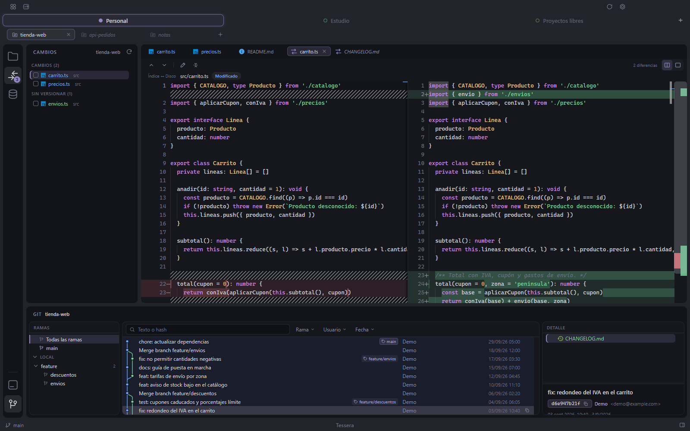

- **Changes**: stage, unstage, discard (always with confirmation) and ignore. You commit in the terminal or
  ask the agent to do it.
- **History** with a branch graph, filters, commit details and the history of a single file.
- **Editable diffs** on your working copy.
- **Several repositories** in one project folder, also in subfolders (up to four levels).

### Terminals

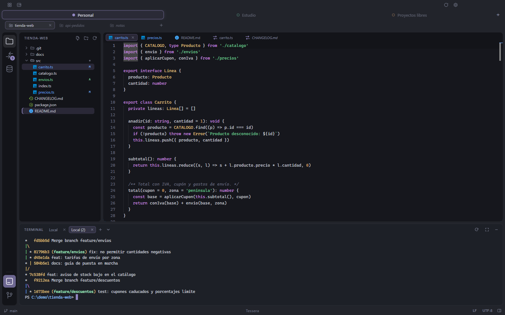

- Several terminals in tabs for the active project, with your own shell.
- **Colored logs**: errors, warnings, dates, IPs, URLs and HTTP codes are highlighted without changing the
  text you copy, also over SSH. You can turn this off in Settings.
- **Full screen** with a button or with Ctrl+Shift+Enter (⇧⌘↩), and next to it the **terminal agent**, which
  belongs to the profile, to get help with your servers without opening a project.

### SSH connections

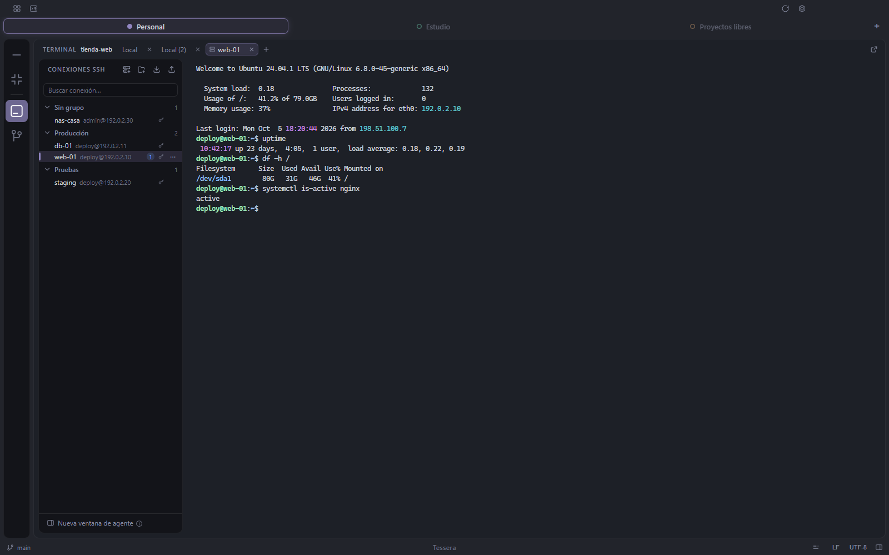

- **Connections per profile**, named and grouped, that open in terminal tabs.
- **Three ways to authenticate**: password, key file or the system's keys. Passwords and key passphrases are
  stored encrypted.
- **Bastions and tunnels**: up to four hops, and local, remote and SOCKS tunnels.
- **Reconnect** from the terminal itself, and SSH tabs come back when you open Tessera.
- **Import and export** in the OpenSSH format (`~/.ssh/config`).
- **SFTP explorer** to browse, create, rename, delete, upload and download, with progress.
- **`tssh` for agents.** They run commands and copy files by the connection's name, without seeing the password
  or the key, and only on servers whose fingerprint a person has already accepted. The **Available to agents**
  checkbox decides which ones they can use.

### Databases

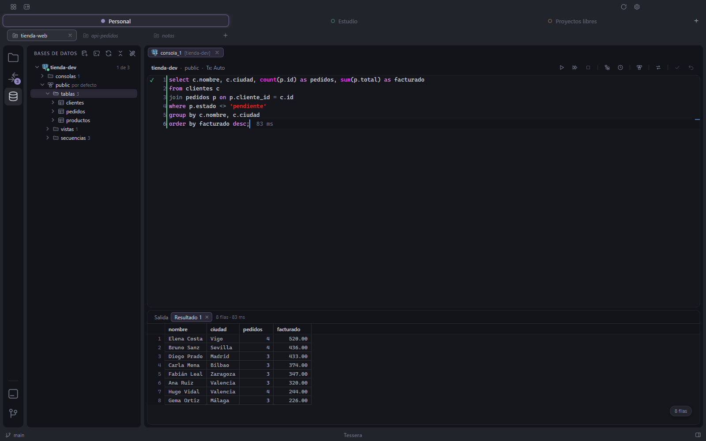

- **Oracle, PostgreSQL, SQL Server, MySQL, MariaDB, MongoDB, Redis and SQLite**, organized by profile. Redis also
  with Sentinel and Cluster.
- **Encrypted connections** (SSL/TLS, and TCPS on Oracle) and **through an SSH tunnel**, also with a bastion.
- Schema and object tree, a grid with paging and export, SQL consoles with autocomplete, formatting, execution
  plans and history, and dedicated consoles for MongoDB and Redis.
- **Editing with confirmation**: changes wait until you submit them, all or nothing. A production connection asks
  for confirmation before writing.
- **`tdb` for agents.** Mount a connection in a project and the agent can query it by name, without seeing the
  password. Writes through `tdb` skip the production confirmation: to prevent them, leave the connection on
  **Read-only for agents**, which does not limit what you do in the view.
- **Database view agent**, which belongs to the profile, native or in Docker.
- Passwords are encrypted with the system's secret store (DPAPI on Windows, the Keychain on macOS, GNOME Keyring
  or KWallet on Linux).

### Settings

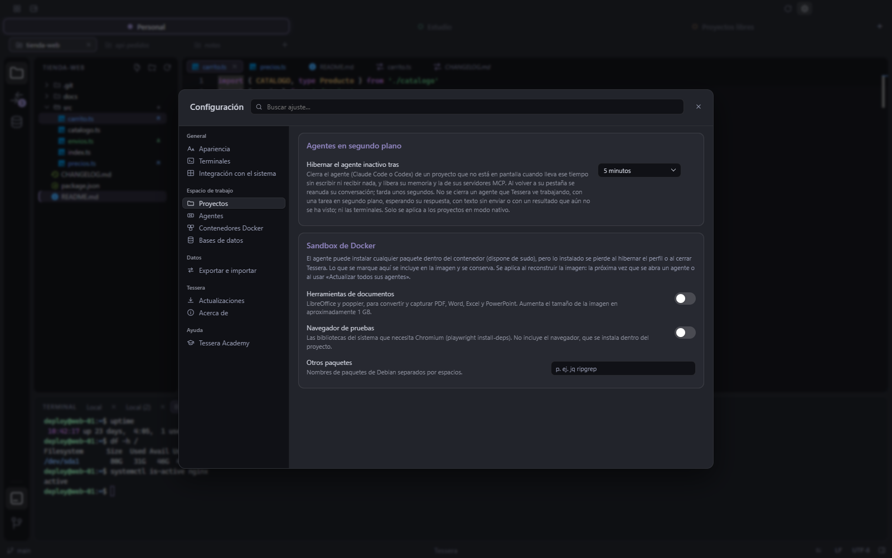

- A window with a search box (Ctrl+, / ⌘,), with the interface in English or Spanish.
- **Export and import** takes your profiles, connections, agents and preferences to another computer, in a
  `.tessera` file encrypted with a passphrase. Optionally, the conversations too. When importing, each profile can
  be created as new or added to an existing one.

## Keyboard shortcuts

| Action | Windows and Linux | macOS |
| --- | --- | --- |
| Settings | Ctrl+, | ⌘, |
| Find in files | Ctrl+Shift+F | ⇧⌘F |
| Show or hide the terminal | Ctrl+` | ⌃` |
| Enter or leave the mosaic | Ctrl+Shift+M | ⇧⌘M |
| Focus a mosaic tile | Ctrl+1 … Ctrl+6 | ⌘1 … ⌘6 |
| Enlarge the tile or the terminal | Ctrl+Shift+Enter | ⇧⌘↩ |

The full list, including the database view, is in **Tessera Academy › Keyboard shortcuts**.

## Where your data lives

| Platform | Folder |
| --- | --- |
| Windows | `%APPDATA%\Tessera` |
| macOS | `~/Library/Application Support/Tessera` |
| Linux | `~/.config/Tessera` |

That folder holds your profiles, settings, Docker account sessions, connections (with encrypted passwords), saved
consoles and logs. Writes survive an unexpected shutdown.

**Your projects are never copied.** Tessera opens them where they are; for agents in Docker, it mounts their folders
in the container. The Windows uninstaller asks whether to keep or delete your data, and an update does not change it.

## Privacy

- **No telemetry.** Tessera has no analytics, crash-reporting service or usage tracking. Logs are written only to the
  data folder.
- **Network connections Tessera makes on its own:**
  - the update channel on GitHub (`github.com/NRVH/tessera/releases`);
  - the account usage shown in the agent footer, read from Anthropic's API with that account's token (Codex's is read
    from local files);
  - checking for new agent versions against the npm registry, the Claude Code release channel and, on macOS, Homebrew;
  - when you ask for it, downloading Oracle Instant Client from oracle.com;
  - when building the container image, Docker downloads the base image and packages from its public registries.
- **What each agent does with its provider** (Anthropic for Claude Code, OpenAI for Codex) is governed by that provider
  and your account, not by Tessera.
- **Passwords and keys** are stored encrypted with the system's secret store. Agents reach databases and servers through
  `tdb` and `tssh` without receiving them.

## Building from source

You need **Node.js 22.18 or later** and **Git**; for agents in Docker, Docker as well.

```bash
git clone https://github.com/NRVH/tessera.git
cd tessera
npm ci
npm run dev
```

`npm run dev` opens the app with hot reload and keeps its data in a separate folder, `Tessera-dev`, so it does not touch
an installed copy. To build the installer for the current platform:

```bash
npm run release:win   # Windows: dist/Tessera-<version>-Setup.exe
npm run release:mac   # macOS:   dist/Tessera-<version>-arm64.dmg (and the .zip that updates use)
npm run release:linux # Linux:   dist/Tessera-linux-x86_64.AppImage
```

Each platform is built on that platform. Tests and code organization are covered in
[CONTRIBUTING.en.md](./CONTRIBUTING.en.md).

## Architecture

```
            ┌─────────────── Tessera (your computer) ────────────┐
            │ editor · explorer · Git · terminals · native       │
            │ agents · SSH connections · databases               │
            └───────┬───────────────────┬───────────────┬────────┘
                    │                   │               │
          ┌─────────▼──────┐  ┌─────────▼──────┐  ┌─────▼──────────┐
          │ profile A      │  │ profile A      │  │ profile B      │  one container
          │ account 1      │  │ account 2      │  │ account 1      │  per Docker account,
          │ its projects   │  │ its projects   │  │ its projects   │  with its projects
          │ its session    │  │ its session    │  │ its session    │  and its session
          └────────────────┘  └────────────────┘  └────────────────┘
```

Electron, TypeScript and React. Monaco for the editor, xterm.js and node-pty for terminals, the system `git` binary for
Git, the system OpenSSH client for SSH and SFTP, and Docker for containers. Design decisions are in
[`docs/decisiones/`](./docs/decisiones/README.md).

## Contributing

Issues and pull requests are welcome, in English or Spanish. Please read
[CONTRIBUTING.en.md](./CONTRIBUTING.en.md) first. Report vulnerabilities privately, as explained in
[SECURITY.en.md](./SECURITY.en.md). Everyone taking part is expected to follow the
[Code of conduct](./CODE_OF_CONDUCT.en.md).

## License

[MIT](./LICENSE) © 2026 Noé Roberto Vázquez Herrera.

Tessera includes third-party software under its own licenses; see
[THIRD_PARTY_NOTICES.md](./THIRD_PARTY_NOTICES.md).

## Author

Made by **Noé Roberto Vázquez Herrera** · [GitHub](https://github.com/NRVH) ·
[LinkedIn](https://www.linkedin.com/in/noe-vazquez-03863423a/)

If you find Tessera useful and want to support its development, you can do so through
**[PayPal](https://paypal.me/NoeRvH)**.
