<p align="center">
  
</p>

<h1 align="center">Tessera</h1>

<p align="center">
  <strong>El IDE de escritorio para trabajar con agentes de IA: sus proyectos, sus cuentas de Claude Code y Codex, y sus herramientas de desarrollo, en una sola ventana.</strong>
</p>

<p align="center">
  <a href="https://github.com/NRVH/tessera/releases/latest"></a>
  <a href="./LICENSE"></a>
  
</p>

<p align="center">
  <a href="#descarga"><strong>Descargar</strong></a> · <a href="./README.en.md">Read in English</a>
</p>

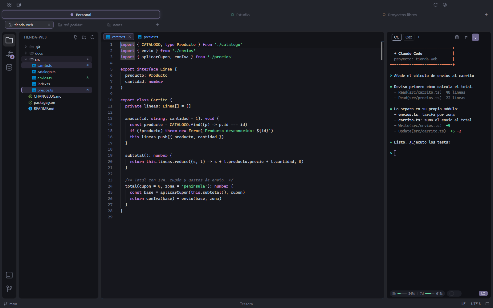

## Qué ofrece Tessera

- **Tantas cuentas como admita su equipo.** Cada agente usa la cuenta iniciada en su equipo o una
  cuenta aislada en Docker. Puede crear varias cuentas de Docker de Claude Code y de Codex, y
  ponerlas a trabajar al mismo tiempo. Tessera no fija un máximo: recomienda un límite según la
  memoria de Docker, y usted puede cambiarlo.
- **El trabajo continúa al cambiar de cuenta o de agente.** A otra cuenta del mismo agente
  (de Claude Code a Claude Code, o de Codex a Codex) pasa la conversación completa. Entre Claude
  Code y Codex pasa un resumen de lo último que se habló y el estado de Git.
- **Usted decide hasta dónde llega cada agente.** En Docker, un agente solo ve los proyectos en los
  que trabaja. Las bases de datos y los servidores SSH los usa por su nombre, sin recibir las
  contraseñas, y se conecta por SSH solo con las claves que usted active, que nunca entran en el contenedor.
- **Las instrucciones se escriben una sola vez.** Las reglas globales llegan a los agentes de Claude
  Code y Codex de todos los perfiles, y las de cada perfil, a los de ese perfil, en cualquier proyecto y
  con cualquier cuenta. Un agente puede proponer cambios, pero solo usted los acepta.
- **Un agente reparte el trabajo.** Un agente de su equipo puede usar las cuentas de Docker de su perfil
  como subagentes: les delega tareas, sin abrir sus ventanas, y recibe el resultado.
- **Todo en un solo lugar.** Editor, explorador de archivos, Git, terminales, conexiones SSH y bases
  de datos junto a los agentes, una rejilla para seguir hasta seis agentes a la vez y una guía
  integrada, Tessera Academy.

## Contenido

- [Varias cuentas al mismo tiempo](#varias-cuentas-al-mismo-tiempo)
- [Continuar en otra cuenta o en otro agente](#continuar-en-otra-cuenta-o-en-otro-agente)
- [Descarga](#descarga)
- [Requisitos](#requisitos)
- [Primeros pasos](#primeros-pasos)
- [Funciones](#funciones)
- [Atajos de teclado](#atajos-de-teclado)
- [Dónde se guardan sus datos](#dónde-se-guardan-sus-datos)
- [Privacidad](#privacidad)
- [Compilar desde el código](#compilar-desde-el-código)
- [Arquitectura](#arquitectura)
- [Contribuir](#contribuir)
- [Licencia](#licencia)
- [Autor](#autor)

## Varias cuentas al mismo tiempo

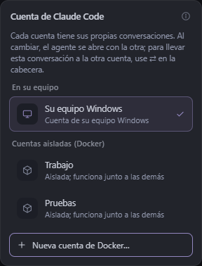

Tessera organiza el trabajo en **perfiles**. Cada perfil tiene su color, sus proyectos y sus cuentas.
Cada agente elige su cuenta en el botón de su cabecera, y Tessera recuerda la elección por agente y
proyecto:

- **La cuenta de su equipo** (agente nativo) es la sesión ya iniciada en Claude Code o Codex. Es la
  opción predeterminada y es la misma en todos los perfiles.
- **Una cuenta de Docker** (cuenta aislada) es una sesión independiente de un agente. Cada una se
  ejecuta en su propio contenedor, con su historial y sus límites de uso, de modo que dos cuentas del
  mismo agente trabajan a la vez sin interferir entre sí. Al crearla se elige si es **privada** de un
  perfil o **global**: una global se usa en todos los perfiles con un solo inicio de sesión, y en cada
  uno ve solo los proyectos, las bases de datos y las conexiones SSH de ese perfil.

La cantidad depende de la capacidad de su equipo. Como referencia, Tessera recomienda 3 contenedores
simultáneos con 8 GB de memoria para Docker, 7 con 16 GB y 14 con 32 GB. Un semáforo indica si el valor
elegido es holgado, justo o excesivo, y también existe la opción **Sin límite**.

<br clear="right">

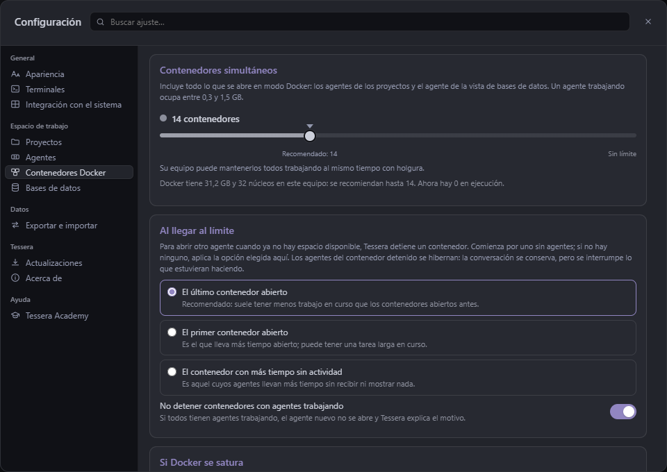

Al llegar al límite, Tessera detiene primero un contenedor sin agentes y, si no hay ninguno, el que
indique la opción elegida. Si la memoria de Docker se satura, avisa antes de detener un agente y le
permite elegir otro. La conversación se conserva y se retoma al volver al agente.

## Continuar en otra cuenta o en otro agente

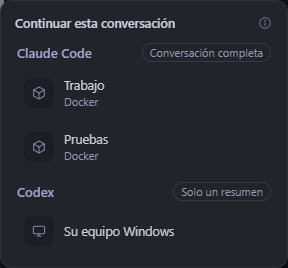

El botón **⇄** de la cabecera del agente reúne las dos opciones:

| Destino | Qué pasa | Cómo sigue |
| --- | --- | --- |
| **Otra cuenta del mismo agente**, en Docker o en su equipo | La conversación completa | El agente la reanuda en esa cuenta |
| **El otro agente**, de Claude Code a Codex o a la inversa | Un resumen: los últimos mensajes de texto y el estado de Git | Una conversación nueva, que lee el resumen y espera sus instrucciones |

La conversación de origen no cambia. Al continuar en otra cuenta se crea una copia: lo que se escriba
en una no aparece en la otra. Los agentes añadidos manualmente no disponen de esta opción.

<br clear="right">

## Descarga

| Plataforma | Descarga directa (última versión) | Sistemas compatibles |
| --- | --- | --- |
| Windows | **[Descargar para Windows](https://github.com/NRVH/tessera/releases/latest/download/Tessera-Setup.exe)** (`.exe`) | Windows 11 (64 bits) |
| macOS | **[Descargar para Mac](https://github.com/NRVH/tessera/releases/latest/download/Tessera-mac-arm64.dmg)** (`.dmg`) | macOS 12 Monterey o posterior, **solo Apple Silicon** (M1 y posteriores) |
| Linux | **[Descargar para Linux](https://github.com/NRVH/tessera/releases/latest/download/Tessera-linux-x86_64.AppImage)** (`.AppImage`) | Distribuciones de escritorio de 64 bits (x86-64) con FUSE (`libfuse2`) |

Las notas de cada versión y los instaladores anteriores están en
**[Releases](https://github.com/NRVH/tessera/releases)**.

El instalador de Windows es por usuario: no solicita permisos de administrador y permite elegir la
carpeta de instalación. En macOS, abra el `.dmg` y arrastre Tessera a **Aplicaciones**. En Linux, dé
permiso de ejecución al AppImage (`chmod +x Tessera-linux-x86_64.AppImage`) y ábralo.

Tessera se actualiza automáticamente en las tres plataformas: descarga la versión nueva en segundo
plano y la aplica al cerrarse. Puede cambiarlo en **Configuración › Actualizaciones**.

### Primer inicio de una aplicación sin firma de pago

Tessera es un proyecto independiente de código abierto y no está firmado con un certificado de pago.
Por ello, Windows y macOS muestran un aviso la primera vez que se abre.

- **Windows.** SmartScreen muestra «Windows protegió su PC». Haga clic en **Más información** y después
  en **Ejecutar de todas formas**.
- **macOS 15 Sequoia y posteriores.** La primera apertura se bloquea. Abra **Ajustes del Sistema ›
  Privacidad y seguridad**, baje hasta el aviso sobre Tessera, haga clic en **Abrir de todos modos** y
  confirme.
- **macOS 12 a 14.** Haga clic derecho (o Control-clic) en Tessera, dentro de Aplicaciones, seleccione
  **Abrir** y confirme.
- **Cualquier versión de macOS, desde la terminal:**

  ```bash
  xattr -dr com.apple.quarantine /Applications/Tessera.app
  ```

Solo es necesario una vez: las actualizaciones las descarga Tessera y no vuelven a mostrar este aviso.
También puede [compilar Tessera desde el código](#compilar-desde-el-código).

En macOS, la aplicación se firma con un certificado propio de Tessera, el mismo en todas las versiones,
de modo que los permisos concedidos se conservan al actualizar. El Llavero vuelve a preguntar una vez
tras cada actualización si Tessera puede usar sus contraseñas: haga clic en **Permitir siempre**.

## Requisitos

| Qué | Cuándo es necesario |
| --- | --- |
| **Docker** | Solo para las cuentas de Docker: Docker Desktop en Windows (con el backend de WSL 2) y en macOS, y el Docker del sistema en Linux (Docker sin root no es compatible). Tessera construye la imagen del contenedor la primera vez que hace falta y, si Docker está detenido, lo inicia al abrir un agente de Docker o delegar una tarea. |
| **Claude Code** y **Codex** | Para los agentes nativos, al menos uno, instalado en su equipo y con la sesión iniciada. En Docker, ambos vienen incluidos en la imagen. Cada cuenta requiere su propia suscripción al proveedor. |
| **Git** | Para la vista de Git. En macOS se incluye en las Command Line Tools de Xcode. |
| **Cliente OpenSSH** | Para las conexiones SSH. En Windows es la función opcional «Cliente OpenSSH», instalada de forma predeterminada; si falta, Tessera usa el de Git y lo indica. En macOS y en la mayoría de las distribuciones de Linux se incluye en el sistema. |
| **GNOME Keyring o KWallet** | Solo en Linux, para guardar contraseñas. Sin ellos, las conexiones se crean igual, pero Tessera no guarda sus contraseñas. |
| **Memoria** | Tessera ocupa de 400 a 800 MB, y cada agente abierto, de 0,3 a 1,5 GB según sus servidores MCP. Si queda poca memoria, Tessera hiberna antes los agentes nativos que no se están usando y lo avisa. |
| **Java** (opcional) | Para descompilar archivos `.class`. Tessera incluye dos motores: CFR (Java 6 o posterior) y Vineflower (Java 17 o posterior). |

## Primeros pasos

1. **Abra Tessera.** Una instalación nueva se inicia con el perfil **Personal**. Para crear otro, haga
   clic en el **+** del final de la barra de perfiles. El clic derecho sobre un perfil permite
   renombrarlo, cambiar su color, escribir sus reglas, hibernarlo o eliminarlo.
2. **Añada un proyecto** con el **+** de la barra de proyectos y seleccione su carpeta. Puede ser un
   repositorio o una carpeta que contiene varios.
3. **Elija la cuenta del agente** con el botón de cuenta de su cabecera: **En su equipo** o **Cuentas
   aisladas (Docker)**. Para crear una, seleccione **Nueva cuenta de Docker…**.
4. **Inicie sesión.** En una cuenta de Docker nueva, el panel del agente ofrece **Iniciar sesión**. Un
   agente nativo usa la sesión ya iniciada en su equipo.

Dentro de la aplicación, **Configuración › Tessera Academy** explica cada función paso a paso, en
español y en inglés. El botón **ⓘ** de los diálogos abre la sección correspondiente.

## Funciones

### Perfiles y proyectos

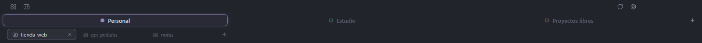

- Dos niveles de pestañas: arriba los perfiles, cada uno con su color, y debajo los proyectos abiertos
  de ese perfil. Se reordenan arrastrándolos.
- **Perfiles en un selector compacto** (Configuración › Apariencia): sustituye la barra de perfiles por
  un selector en la barra de título.
- Tessera restaura los proyectos abiertos de cada perfil sin iniciar todos los agentes a la vez: un
  agente se inicia al entrar en su proyecto.
- **Cada proyecto se reabre como lo dejó**: sus archivos, el modo de vista y la línea del cursor, las
  carpetas desplegadas y sus terminales. La ventana vuelve a su monitor, con su tamaño y su posición.
- **Hibernar un perfil** detiene sus contenedores y libera su memoria; al volver, se reanuda.
- **Los agentes nativos inactivos se hibernan** tras unos minutos (5 de forma predeterminada, o nunca) y
  retoman su conversación al volver. No ocurre si el agente trabaja, espera una respuesta o tiene texto
  sin enviar.

### Agentes

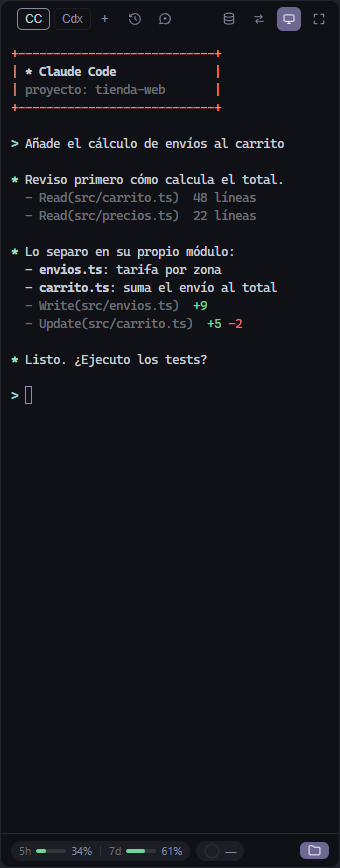

- **Claude Code y Codex** en cada proyecto, en una terminal real.
- **Historial de conversaciones** por proyecto y cuenta: permite reanudarlas o eliminarlas. Al abrir un
  proyecto se reanuda su última conversación.
- **Uso de la cuenta** en el pie del agente, con los límites de su plan, y cuánto ocupa la conversación
  en la **ventana de contexto**. **Uso de las cuentas**, en la barra de estado, lista todas las del perfil
  con sus límites de 5 horas y semanal, y permite fijar hasta dos a la vista.
- **Delegar tareas en subagentes.** Un agente de su equipo usa las cuentas de Docker de su perfil como
  subagentes: manda una tarea a una de ellas con `tctx delegar`, espera el resultado y sigue, sin que se
  abra la terminal de esa cuenta. Con `tctx cuentas`
  ve el uso disponible de cada una (o deja que Tessera elija la más libre), con `tctx modelos` los modelos y esfuerzos
  que ofrece, y con `tctx tarea` vigila, cancela o continúa una tarea larga, también tras un corte de luz. Mientras haya tareas en marcha, un indicador en la cabecera del agente las
  muestra con su cuenta, el uso de esa cuenta y su tiempo, y permite cancelarlas.
- **Los archivos de cada cuenta**, editables en Tessera: la configuración (`settings.json`, `config.toml`) y
  las instrucciones (`CLAUDE.md`, `AGENTS.md`) de una cuenta de Docker o del agente de su equipo, en el
  diálogo **Contexto de los agentes**. **Editar configuración…**, en el menú **⋯** de una cuenta de Docker,
  lo abre con esa cuenta elegida.
- **Cuentas de Docker en Configuración › Agentes.** Cada agente despliega allí sus cuentas para crearlas,
  renombrarlas, iniciar o cerrar su sesión y eliminarlas, también si el agente está oculto. El selector de
  cuenta de la cabecera lleva allí con **Administrar las cuentas…**.
- **Búsqueda en lo que se habló.** Con `tctx buscar`, un agente recupera lo tratado en las conversaciones
  del proyecto. En Docker busca solo en las de su propia cuenta.
- **Ventanas de agente.** Un agente nativo en una ventana aparte, sin perfil ni proyecto, desde **Nueva
  ventana de agente**.
- **Actualizar los agentes.** En los nativos, un botón comprueba si hay versión nueva, la instala y
  reinicia las sesiones necesarias, cada una en su conversación; espera a las que están trabajando o
  esperan una respuesta. El mismo botón actualiza los agentes en Docker reconstruyendo su imagen.
- **Imágenes y archivos** se pueden pegar en la terminal del agente; en Docker se copian al contenedor.
- **Cualquier otro agente de terminal**, añadido manualmente con su nombre, su comando y dónde se ejecuta.
  No dispone de historial, uso de la cuenta ni hibernación automática.

### Contexto de los agentes

Lo que reciben los agentes se organiza en dos niveles: el **global**, para los agentes de todos los perfiles
que lo usan, y el **de cada perfil**, que se suma después. Cada perfil decide si usa el global. Cada nivel
tiene tres partes:

- **Reglas.** Un texto con sus instrucciones (ramas, qué no modificar, cómo nombrar los commits), el mismo
  para Claude Code y Codex, que los agentes reciben al iniciarse, en su equipo y en Docker. Si una regla del
  perfil contradice una global, prevalece la del perfil. Con `tctx proponer`, un agente propone un cambio y
  usted revisa la diferencia antes de aceptarla.
- **Documentos.** Carpetas de su equipo con documentos de referencia, como un contrato o una guía. No se
  cargan en cada sesión: los agentes los consultan por su nombre con `tctx docs`, también en Docker.
- **Configuración de Docker.** El modelo, los permisos y los servidores MCP de los agentes en Docker, para
  todas las cuentas o para una. Se aplica al abrir cada sesión, sin modificar los archivos de la cuenta. Un
  agente la consulta con `tctx config` y propone cambios con `tctx config proponer`.

El **Resumen** de un perfil enseña lo que recibe un agente: las reglas y los documentos ya combinados con los
globales, cuánto ocupan y lo que añade Tessera por su cuenta. Todo se edita en el diálogo **Contexto de los
agentes**, que se abre desde **Configuración › Agentes** o con **Reglas para los agentes…** en el menú del
perfil.

### Nativo o en Docker, por agente

| | Nativo | Docker |
| --- | --- | --- |
| **Cuenta** | La iniciada en su equipo, una por agente | Las que cree, por agente y perfil, cada una en su contenedor |
| **Qué ve** | Lo mismo que usted, con sus permisos | Los proyectos en los que trabaja y su propia cuenta; se conecta por SSH solo con las claves que usted active, sin recibirlas |
| **Necesita Docker** | No | Sí |
| **Conveniente para** | Herramientas y VPN de su equipo | Separar cuentas y limitar qué ve el agente |

Un agente en Docker puede modificar los proyectos que tiene montados y usar la red; lo demás de su disco
no está a su alcance. Dispone de `sudo` dentro del contenedor, sin privilegios adicionales de Docker, y lo
que instale se pierde al detenerse. Para conservarlo, inclúyalo en la imagen desde **Configuración ›
Proyectos**. **Codex en Docker** requiere elegir **Full Access** con `/permissions`, porque su propio
sandbox no puede iniciarse dentro de un contenedor; Tessera no activa ese modo automáticamente.

Al iniciarse, el agente en Docker recibe de Tessera cómo es su contenedor: qué se pierde al recrearlo, cómo
instalar herramientas, que dentro no hay Docker, los límites de `tdb` y, en Windows y macOS, cómo llegar a
los servicios de su equipo. Así no lo descubre fallando.

La terminal inferior siempre es nativa. Un agente nativo no está aislado: tiene los mismos permisos que
usted, igual que si lo iniciara desde una terminal.

### Mosaico de agentes

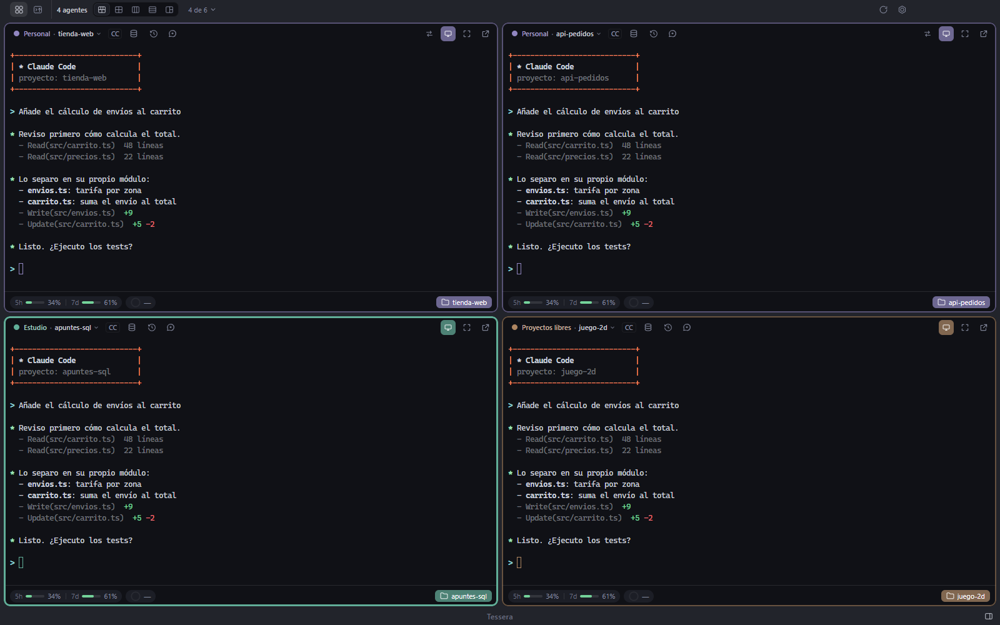

Una rejilla con hasta seis agentes visibles, de cualquier proyecto y perfil, también el de la terminal y
el de la vista de bases de datos. Permite saltar a una casilla, ampliarla y salir con el mismo atajo.

### Editor y visores

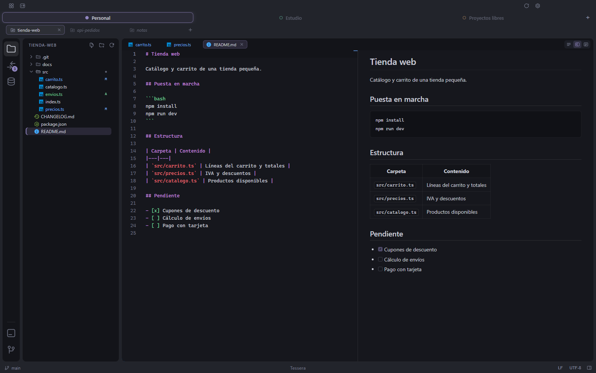

- **Monaco**, con resaltado de sintaxis, buscar y reemplazar, y pestañas por proyecto.
- **Temas, fuente y tamaño del código**: once temas, que se aplican al editor, los diffs, los visores y
  los editores de bases de datos.
- **Codificación y fin de línea** de cada archivo, visibles en la barra de estado y convertibles.
- **Markdown** con vista renderizada (incluye diagramas Mermaid), de código, o ambas con desplazamiento
  sincronizado. Los HTML tienen una vista previa aislada.
- **Visores** de PDF, Word (`.docx`), ZIP, imágenes, audio y vídeo.
- **Archivos de Java**: los `.jar`, `.war`, `.ear` y `.aar` se abren como carpetas y los `.class` se
  descompilan al abrirlos, también al comparar dos versiones.

### Explorador de archivos

- Selección múltiple, arrastrar y soltar para mover, crear, renombrar y eliminar.
- **Buscar en archivos** en todo el proyecto o en una carpeta, con vista previa.
- Colores de estado de Git, actualizados según cambian los archivos en disco.
- **«Abrir con Tessera»** desde el gestor de archivos del sistema, en las tres plataformas. Tessera nunca
  se convierte en la aplicación predeterminada de un tipo de archivo.

### Git

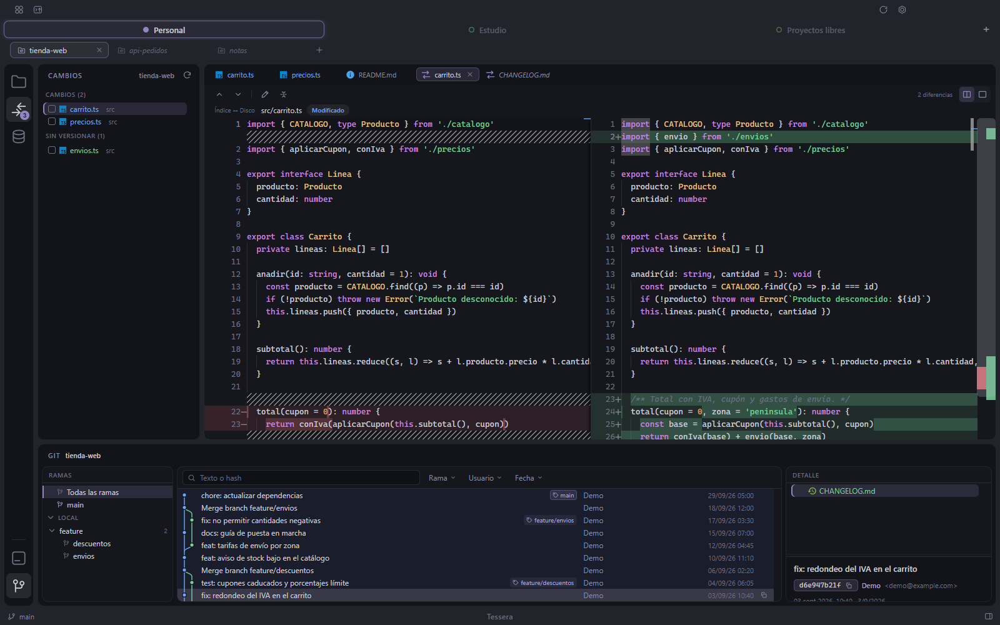

- **Cambios**: preparar, quitar del índice, descartar (siempre con confirmación) e ignorar. El commit se
  hace en la terminal o se le solicita al agente.
- **Historial** con grafo de ramas, filtros, detalle de cada commit e historial de un archivo.
- **Diffs editables** sobre la copia de trabajo.
- **Los hooks del repositorio piden permiso**: uno nuevo o que cambió se enseña antes de ejecutarse en su
  equipo, y usted decide si lo ejecuta, continúa sin él o cancela.
- **Varios repositorios** en una misma carpeta de proyecto, también en subcarpetas (hasta cuatro niveles).

### Terminales

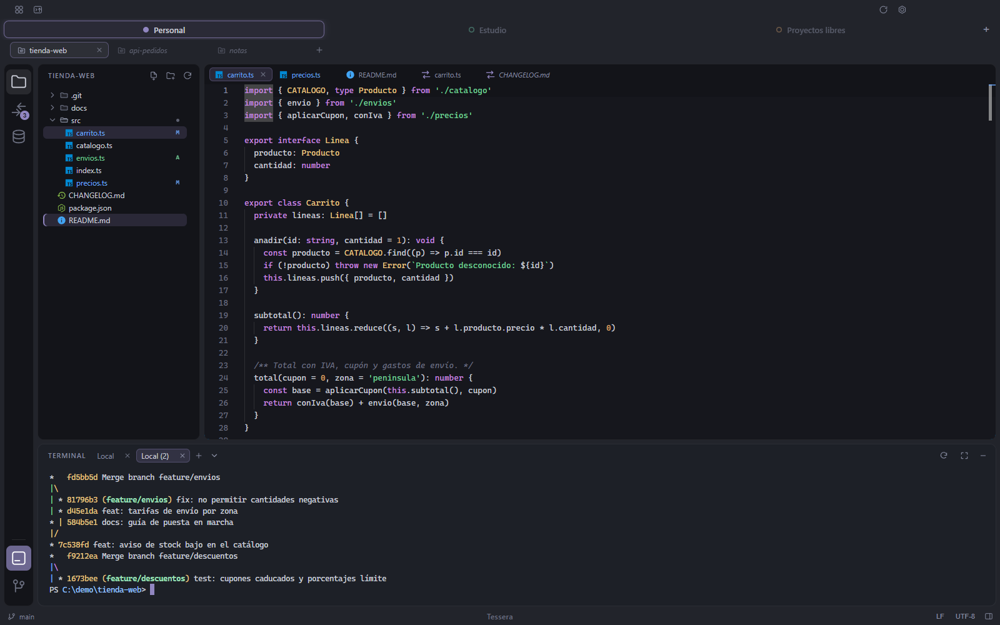

- Varias terminales en pestañas para el proyecto activo, con su propia shell. Las pestañas, locales y SSH,
  se reordenan arrastrándolas, y cada proyecto conserva su orden.
- **Registros con color**: errores, avisos, fechas, IP, URL y códigos HTTP se resaltan sin cambiar el texto
  que se copia, también por SSH. Se desactiva en Configuración.
- **Pantalla completa** con un botón o con Ctrl+Shift+Enter (⇧⌘↩), y a su lado el **agente de la terminal**,
  propio del perfil, para obtener ayuda con sus servidores sin abrir un proyecto.

### Conexiones SSH

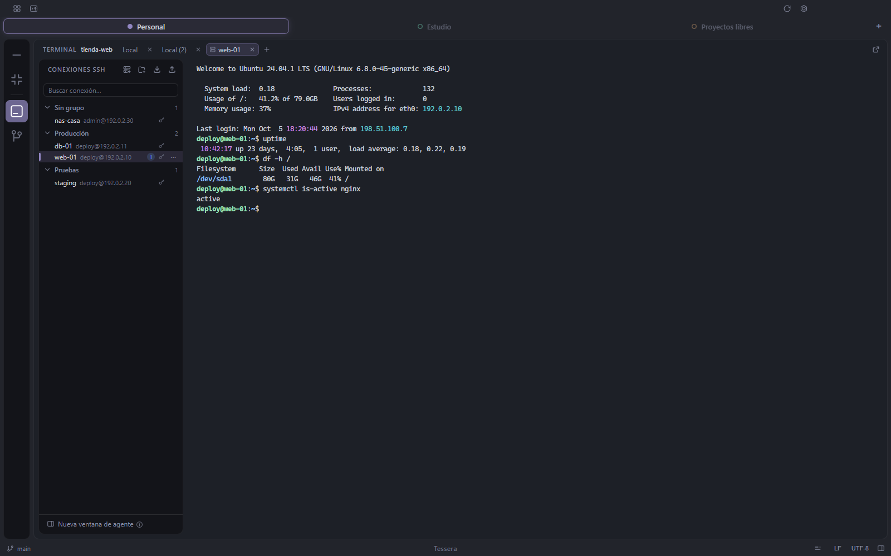

- **Conexiones de cada perfil**, con nombre y en grupos, que se abren en pestañas de la terminal.
- **Tres formas de autenticación**: contraseña, archivo de clave o las claves del sistema. Las contraseñas
  y frases de clave se guardan cifradas.
- **La huella de un servidor nuevo se enseña antes de enviar la contraseña**, también en cada bastión.
- **Bastiones y túneles**: hasta cuatro saltos, y túneles locales, remotos y SOCKS.
- **Reconexión** desde la propia terminal, y las pestañas SSH vuelven al abrir Tessera.
- **Importar y exportar** con el formato de OpenSSH (`~/.ssh/config`).
- **Explorador SFTP** para navegar, crear, renombrar, eliminar, subir y descargar, con progreso.
- **`tssh` para los agentes.** Ejecutan órdenes y copian archivos por el nombre de la conexión, sin ver la
  contraseña ni la clave, y solo en servidores cuya huella ya aceptó una persona. El interruptor **Disponible
  para los agentes** decide cuáles pueden usar.
- **Claves SSH de los agentes en Docker.** Por perfil, usted activa con qué claves pueden conectarse. Las claves
  privadas permanecen en su equipo: el agente pide cada firma a Tessera. No limita a los agentes nativos.

### Bases de datos

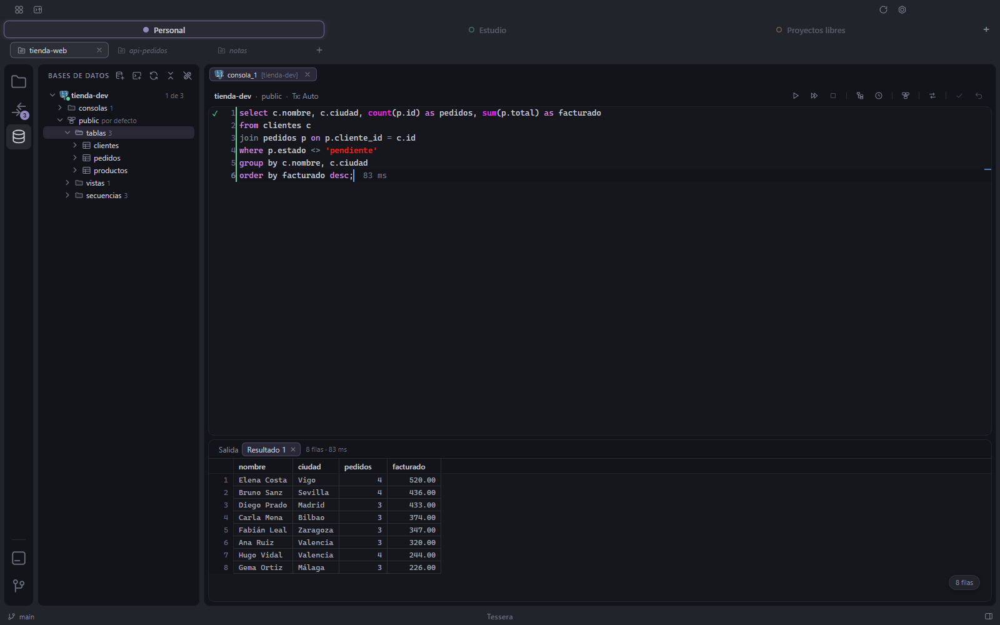

- **Oracle, PostgreSQL, SQL Server, MySQL, MariaDB, MongoDB, Redis y SQLite**, organizados por perfil. Redis
  también con Sentinel y Cluster.
- **Conexiones cifradas** (SSL/TLS, y TCPS en Oracle) y **por un túnel SSH**, también con bastión.
- Árbol de esquemas y objetos, rejilla con paginado y exportación, consolas SQL con autocompletado, formato,
  planes de ejecución e historial, y consolas propias para MongoDB y Redis.
- **Edición con confirmación**: los cambios esperan a que los envíe, todo o nada. Una conexión de producción
  solicita confirmación antes de escribir.
- **`tdb` para los agentes.** Monte una conexión en un proyecto y el agente podrá consultarla por su nombre,
  sin ver la contraseña. Las escrituras de `tdb` no pasan por la confirmación de producción: para impedirlas,
  deje la conexión en **Solo lectura para los agentes**, que no limita lo que usted hace en la vista.
- **Agente de la vista de bases de datos**, propio del perfil, en un agente nativo o en Docker.
- Las contraseñas se cifran con el almacén de secretos del sistema (DPAPI en Windows, el Llavero en macOS,
  GNOME Keyring o KWallet en Linux).

### Configuración

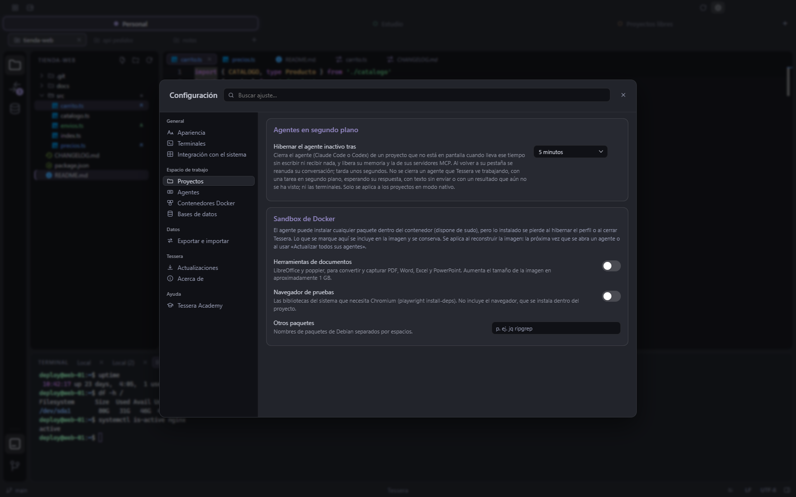

- Una ventana con buscador (Ctrl+, / ⌘,), con la interfaz en español o en inglés.
- **Exportar e importar** lleva sus perfiles, conexiones, agentes, reglas de los agentes y preferencias a otro equipo, en un archivo
  `.tessera` cifrado con una frase. De forma opcional, también las conversaciones. Al importar, cada perfil
  puede crearse como nuevo o añadirse a uno existente.

## Atajos de teclado

| Acción | Windows y Linux | macOS |
| --- | --- | --- |
| Configuración | Ctrl+, | ⌘, |
| Buscar en archivos | Ctrl+Shift+F | ⇧⌘F |
| Mostrar u ocultar la terminal | Ctrl+` | ⌃` |
| Entrar o salir del mosaico | Ctrl+Shift+M | ⇧⌘M |
| Enfocar una casilla del mosaico | Ctrl+1 … Ctrl+6 | ⌘1 … ⌘6 |
| Ampliar la casilla o la terminal | Ctrl+Shift+Enter | ⇧⌘↩ |

La lista completa, también la de la vista de bases de datos, está en **Tessera Academy › Atajos de teclado**.

## Dónde se guardan sus datos

| Plataforma | Carpeta |
| --- | --- |
| Windows | `%APPDATA%\Tessera` |
| macOS | `~/Library/Application Support/Tessera` |
| Linux | `~/.config/Tessera` |

Esa carpeta contiene sus perfiles, la configuración, las sesiones de las cuentas de Docker, las conexiones
(con las contraseñas cifradas), las consolas guardadas y los registros. Las escrituras resisten un cierre
inesperado.

**Sus proyectos nunca se copian.** Tessera los abre donde están; para los agentes en Docker, monta sus carpetas
en el contenedor. El desinstalador de Windows pregunta si desea conservar o borrar los datos, y una
actualización no los modifica.

## Privacidad

- **Sin telemetría.** Tessera no tiene analítica, ni servicio de informes de fallos, ni seguimiento de uso. Los
  registros se escriben solo en la carpeta de datos.
- **Conexiones de red que Tessera realiza por su cuenta:**
  - el canal de actualizaciones en GitHub (`github.com/NRVH/tessera/releases`);
  - el uso de la cuenta que muestra el pie del agente, leído de la API de Anthropic con el token de esa cuenta
    (el de Codex se lee de archivos locales);
  - la comprobación de versiones nuevas de los agentes en el registro de npm, el canal de versiones de Claude
    Code y, en macOS, Homebrew;
  - a petición del usuario, la descarga de Oracle Instant Client desde oracle.com;
  - al construir la imagen del contenedor, Docker descarga la imagen base y los paquetes de sus registros
    públicos.
- **Lo que cada agente hace con su proveedor** (Anthropic en Claude Code, OpenAI en Codex) lo rigen ese proveedor
  y su cuenta, no Tessera.
- **Las contraseñas y las claves** se guardan cifradas con el almacén de secretos del sistema. Los agentes llegan
  a las bases de datos y a los servidores por `tdb` y `tssh` sin recibirlas.

## Compilar desde el código

Requiere **Node.js 22.18 o posterior** y **Git**; para los agentes en Docker, también Docker.

```bash
git clone https://github.com/NRVH/tessera.git
cd tessera
npm ci
npm run dev
```

`npm run dev` abre la aplicación con recarga en caliente y guarda sus datos en una carpeta aparte, `Tessera-dev`,
de modo que no toca una copia instalada. Para generar el instalador de la plataforma actual:

```bash
npm run release:win   # Windows: dist/Tessera-<versión>-Setup.exe
npm run release:mac   # macOS:   dist/Tessera-<versión>-arm64.dmg (y el .zip que usan las actualizaciones)
npm run release:linux # Linux:   dist/Tessera-linux-x86_64.AppImage
```

Cada plataforma se compila en esa plataforma. Las pruebas y la organización del código se explican en
[CONTRIBUTING.md](./CONTRIBUTING.md).

## Arquitectura

```
            ┌──────────────── Tessera (su equipo) ───────────────┐
            │ editor · explorador · Git · terminales · agentes   │
            │ nativos · conexiones SSH · bases de datos          │
            └───────┬───────────────────┬───────────────┬────────┘
                    │                   │               │
          ┌─────────▼──────┐  ┌─────────▼──────┐  ┌─────▼──────────┐
          │ perfil A       │  │ perfil A       │  │ perfil B       │  un contenedor
          │ cuenta 1       │  │ cuenta 2       │  │ cuenta 1       │  por cuenta de Docker,
          │ sus proyectos  │  │ sus proyectos  │  │ sus proyectos  │  con sus proyectos y
          │ su sesión      │  │ su sesión      │  │ su sesión      │  su sesión
          └────────────────┘  └────────────────┘  └────────────────┘
```

Electron, TypeScript y React. Monaco para el editor, xterm.js y node-pty para las terminales, el binario `git` del
sistema para Git, el cliente OpenSSH del sistema para SSH y SFTP, y Docker para los contenedores. Las decisiones de
diseño están en [`docs/decisiones/`](./docs/decisiones/README.md).

## Contribuir

Los issues y los pull requests son bienvenidos, en español o en inglés. Consulte antes
[CONTRIBUTING.md](./CONTRIBUTING.md). Las vulnerabilidades se reportan en privado, como explica
[SECURITY.md](./SECURITY.md). Se espera que quienes participen sigan el [Código de conducta](./CODE_OF_CONDUCT.md).

## Licencia

[MIT](./LICENSE) © 2026 Noé Roberto Vázquez Herrera.

Tessera incluye software de terceros con sus propias licencias; consulte
[THIRD_PARTY_NOTICES.md](./THIRD_PARTY_NOTICES.md).

## Autor

Desarrollado por **Noé Roberto Vázquez Herrera** · [GitHub](https://github.com/NRVH) ·
[LinkedIn](https://www.linkedin.com/in/noe-vazquez-03863423a/)

Si Tessera le resulta útil y desea apoyar su desarrollo, puede hacerlo por
**[PayPal](https://paypal.me/NoeRvH)**.
