<p align="center">
  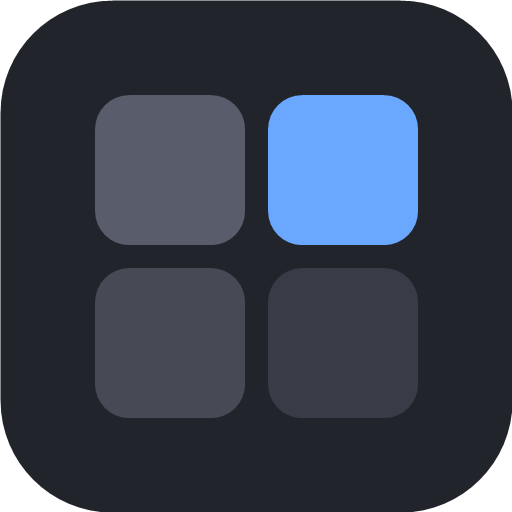
</p>

<h1 align="center">Tessera</h1>

<p align="center">
  <strong>El IDE de escritorio para quien trabaja en varios proyectos y con varias cuentas de IA.</strong>
</p>

<p align="center">
  <a href="https://github.com/NRVH/tessera/releases/latest"></a>
  <a href="./LICENSE"></a>
  
</p>

<p align="center">
  <a href="./README.en.md">Read in English</a>
</p>

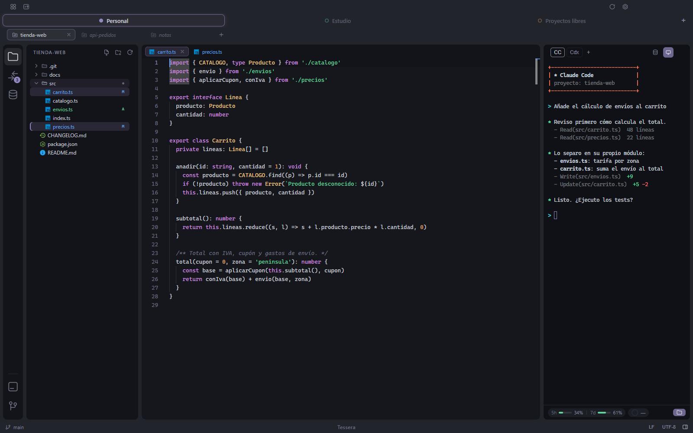

Los agentes de IA para programar son potentes, y también son un tipo nuevo de proceso que
corre en tu equipo con tus permisos. Tessera ordena tus proyectos en **espacios de
trabajo**, corre Claude Code y Codex a su lado y te deja decidir agente por agente hasta
dónde llega un agente: en nativo, con la cuenta de tu equipo, o dentro del sandbox de Docker
del espacio de trabajo, con una cuenta propia de ese espacio y solo sus proyectos a la vista.


## Contenido

- [Por qué Tessera](#por-qué-tessera)
- [Descarga](#descarga)
- [Requisitos](#requisitos)
- [Primeros pasos](#primeros-pasos)
- [Funciones](#funciones)
- [Atajos de teclado](#atajos-de-teclado)
- [Dónde se guardan tus datos](#dónde-se-guardan-tus-datos)
- [Privacidad](#privacidad)
- [Compilar desde el código](#compilar-desde-el-código)
- [Arquitectura](#arquitectura)
- [Pruebas](#pruebas)
- [Contribuir](#contribuir)
- [Licencia](#licencia)
- [Autor](#autor)

## Por qué Tessera

- **Varias cuentas de IA, cada una en su sitio.** Cada agente elige dónde corre en el botón de
  cuenta de su cabecera. **Nativo** (el valor por defecto) usa la cuenta de Claude Code o de
  Codex que ya tienes iniciada en tu equipo, la misma en todos los espacios de trabajo. Una
  cuenta de **Docker** es del espacio de trabajo: inicias sesión una vez dentro de ese
  espacio, se guarda con él y nunca se comparte con ningún otro. Pon tu plan personal, el de
  tu equipo o una cuenta ligada a un proyecto en su propio espacio, elige esa cuenta en el
  agente, y cada una conserva su historial de conversaciones y sus límites de uso, sin cerrar
  sesión cada vez que cambias. Un espacio puede tener varias cuentas del mismo agente, cada
  una en su propio contenedor, trabajando a la vez.
- **Un agente en Docker solo ve lo que tú le das.** Corre dentro del contenedor de su espacio
  de trabajo, con los proyectos de ese espacio montados y nada más: ni tu carpeta personal, ni
  tus otros repositorios, ni el resto del disco. Un comando equivocado o un prompt malicioso se
  quedan dentro de la caja. Un agente nativo corre como tú, con tus permisos, igual que
  cualquier agente que arrancas desde una terminal.
- **El control es tuyo.** Los agentes abren en nativo salvo que elijas una cuenta de Docker, y
  cada agente de cada proyecto recuerda su elección. Las credenciales del agente se montan solo mientras el agente corre. El acceso
  a bases de datos pasa por un CLI pequeño que nunca le enseña una contraseña al agente, y
  una conexión puede ser de solo lectura para los agentes. Con las conexiones SSH pasa lo
  mismo: el agente entra en tus servidores con `tssh` sin ver la contraseña ni la clave.
- **Todo en una ventana.** Editor, explorador de archivos, Git, terminales, conexiones SSH y
  conexiones a bases de datos junto a los agentes, con una pestaña por espacio de trabajo y una
  subpestaña por proyecto.

## Descarga

| Plataforma | Descarga directa (última versión) | Sistemas soportados |
| --- | --- | --- |
| Windows | **[Descargar para Windows](https://github.com/NRVH/tessera/releases/latest/download/Tessera-Setup.exe)** (`.exe`) | Windows 11 (64 bits) |
| macOS | **[Descargar para Mac](https://github.com/NRVH/tessera/releases/latest/download/Tessera-mac-arm64.dmg)** (`.dmg`) | macOS 12 Monterey o posterior, **solo Apple Silicon** (M1 y posteriores) |
| Linux | **[Descargar para Linux](https://github.com/NRVH/tessera/releases/latest/download/Tessera-linux-x86_64.AppImage)** (`.AppImage`) | Distribuciones de escritorio de 64 bits (x86-64) con FUSE (`libfuse2`) |

Las notas de cada versión y los instaladores anteriores están en
**[Releases](https://github.com/NRVH/tessera/releases)**.

El instalador de Windows es por usuario (no pide permisos de administrador) y te deja elegir
la carpeta de instalación. En macOS, abre el `.dmg` y arrastra Tessera a **Aplicaciones**. En
Linux, dale permiso de ejecución al AppImage (`chmod +x Tessera-linux-x86_64.AppImage`) y ábrelo.

Tessera se actualiza sola en las tres plataformas: la versión nueva se descarga en segundo
plano y se aplica al cerrar la app (puedes cambiarlo en **Configuración › Actualizaciones**).

### Primer arranque de una app sin firma de pago

Tessera es un proyecto de código abierto independiente y no está firmado con un
certificado de pago, así que Windows y macOS avisan la primera vez que la abres. Es lo
esperado.

- **Windows.** SmartScreen enseña «Windows protegió tu PC». Pulsa **Más información** y
  después **Ejecutar de todas formas**.
- **macOS 15 Sequoia y posteriores.** La primera apertura se bloquea. Ve a **Ajustes del
  Sistema › Privacidad y seguridad**, baja hasta el aviso sobre Tessera, pulsa **Abrir de
  todos modos** y confirma.
- **macOS 12 a 14.** Haz clic derecho (o Control-clic) sobre Tessera en Aplicaciones, elige
  **Abrir** y confirma.
- **Cualquier versión de macOS, desde la terminal:**

  ```bash
  xattr -dr com.apple.quarantine /Applications/Tessera.app
  ```

Solo hay que hacerlo una vez: las actualizaciones automáticas las descarga la propia
Tessera y no vuelven a disparar el aviso. Si prefieres no fiarte de un binario ya
compilado, puedes [compilar Tessera desde el código](#compilar-desde-el-código).

En macOS la app va firmada con un certificado propio de Tessera, el mismo en todas las
versiones, así que los permisos que le des (acceso a carpetas, Accesibilidad, grabación de
pantalla) se conservan al actualizar. El Llavero sí vuelve a preguntar una vez tras cada
actualización si Tessera puede usar sus contraseñas guardadas: pulsa **Permitir siempre**.

## Requisitos

| Qué | Cuándo lo necesitas |
| --- | --- |
| **Docker** | Solo para los agentes que usan una cuenta de Docker: Docker Desktop en Windows (con el backend de WSL 2) y en macOS, y el Docker del sistema en Linux (Docker sin root no está soportado: Tessera lo explica y propone usar el agente nativo). Tessera construye la imagen del sandbox la primera vez que un espacio de trabajo la necesita. |
| **Claude Code** y/o **Codex** | Para los agentes nativos: instalados en tu equipo y con la sesión iniciada. En Docker los dos vienen preinstalados en la imagen. |
| **Git** | Para la vista de Git, que corre en tu equipo. En macOS viene con las Command Line Tools de Xcode. |
| **Cliente OpenSSH** | Para las conexiones SSH. En Windows es la función opcional «Cliente OpenSSH», que viene instalada en Windows 10 y 11 (si falta, Tessera usa el de Git y lo avisa); en macOS y en la mayoría de distribuciones de Linux viene con el sistema. |
| **GNOME Keyring o KWallet** | Solo en Linux, para guardar contraseñas. Sin uno de los dos, las conexiones se crean igual, pero Tessera no guarda su contraseña: nunca la deja en el disco casi en claro. |
| **Memoria** | Tessera ocupa de 400 a 800 MB, y cada agente abierto suma de 0,3 a 1,5 GB según sus servidores MCP. Con 4 GB caben uno o dos agentes; con 8 GB o más, los que uses. Si al equipo le queda poca memoria, Tessera hiberna antes los agentes que no estés usando y te avisa. |
| **Java** (opcional) | Para descompilar archivos `.class`. Tessera trae dos motores: CFR, que corre con Java 6 o posterior, y Vineflower, que necesita Java 17 o posterior. Encuentra todas las instalaciones de Java del equipo y usa la mejor para cada motor. |

## Primeros pasos

1. **Abre Tessera.** Una instalación nueva arranca con un espacio de trabajo llamado
   **Personal**. En la interfaz, los espacios de trabajo se llaman *perfiles*.
2. **Crea más espacios de trabajo** con el **+** del final de la barra de perfiles: dale a
   cada uno un nombre y un color. Con clic derecho sobre un perfil lo renombras, le cambias
   el color, lo hibernas o lo eliminas, y arrastrándolo lo reordenas.
3. **Añade proyectos** con el **+** de la barra de proyectos («Abrir proyecto») y elige una
   carpeta. Un proyecto puede ser un solo repositorio o una carpeta que contiene varios.
4. **Elige la cuenta del agente.** Cada agente abre en nativo: en tu equipo, con la cuenta
   iniciada en él, la misma en todos los espacios. El botón de cuenta de su cabecera abre
   un selector con dos apartados: **En tu equipo** y **En Docker**, con una tarjeta por
   cuenta (cada una en su propio contenedor) y **Nueva cuenta de Docker…** al pie. Desde
   cada tarjeta también la renombras, cierras su sesión o la eliminas. La elección se
   recuerda por agente y proyecto.
5. **Inicia sesión en el agente.** Con una cuenta de Docker nueva, el panel del agente ofrece
   **Iniciar sesión** la primera vez: esa cuenta la pueden usar después los agentes del
   perfil. Un agente nativo usa la cuenta con la que ya tienes la sesión iniciada en tu
   equipo.

## Funciones

### Espacios de trabajo y pestañas

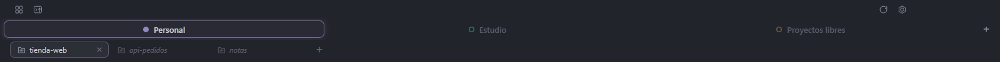

- Dos niveles de pestañas: arriba los espacios de trabajo, cada uno con su color para que
  siempre sepas en qué cuenta estás, y debajo los proyectos abiertos de ese espacio.
- Reordena espacios y proyectos arrastrándolos.
- **Modo minimalista** (Configuración › Apariencia): la barra de espacios se cambia por un
  selector pequeño en el centro de la barra de título, con el espacio activo; al pulsarlo
  salen los demás, con el mismo menú para renombrarlos, cambiarles el color, hibernarlos o
  eliminarlos.
- Tessera recuerda qué proyectos tenía abiertos cada espacio y los restaura al volver a
  abrir la app, sin arrancar todos los agentes a la vez: un agente arranca cuando entras a
  su proyecto.
- **Hiberna un espacio de trabajo** para parar su contenedor y liberar su memoria; se
  despierta donde lo dejaste al volver a él.
- **Los agentes inactivos se hibernan solos**: el agente nativo de un proyecto que no está
  en pantalla se cierra tras unos minutos sin actividad (5 por defecto, o nunca) y retoma su
  conversación al volver. Nunca pasa mientras el agente trabaja, te espera o tiene texto
  sin enviar.
- El contenedor de cada espacio usa por defecto su propia red, o la de tu equipo
  (cuando está activada en Docker Desktop) para que los servidores que levanta un agente se
  alcancen desde tu navegador.

### Claude Code y Codex

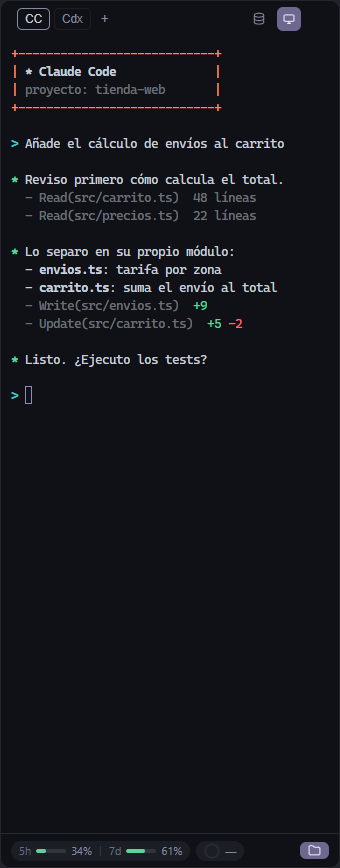

- Los dos agentes están disponibles en cada espacio de trabajo, lado a lado, en una
  terminal de verdad.
- Cada agente elige su cuenta. Los agentes nativos comparten la cuenta iniciada en tu equipo.
  Una cuenta de Docker es propia de su espacio de trabajo, guardada en su propia carpeta y
  nunca compartida con otro espacio. Si quieres una cuenta por espacio, elige una cuenta de
  Docker en el agente.
- **Historial de conversaciones** por proyecto: recorre las conversaciones anteriores,
  reanuda cualquiera o bórralas. Al abrir un proyecto se reanuda su última conversación.
- **Uso de la cuenta** en el pie del agente (los límites de 5 horas y semanal), y cuánto de
  la **ventana de contexto** gasta la conversación actual.
- **Agentes siempre al día.** Para los agentes nativos, un botón comprueba si hay versión nueva
  de Claude Code y de Codex, la instala y reinicia solo las sesiones que lo necesitan, cada una
  en su conversación; espera mientras algún agente afectado siga trabajando. Para los de
  Docker, «Actualizar agentes» reconstruye la imagen del sandbox con las últimas versiones.
- Pega imágenes y archivos en la terminal del agente; si está en Docker se copian dentro del
  contenedor en vez de pasar una ruta que el agente no podría abrir.
- **Cualquier otro agente de terminal**, además de Claude Code y Codex: le das un nombre, el
  comando con que lo arrancarías, dónde corre (nativo, para todo tu equipo, o Docker, para el
  perfil) y, si quieres, cómo reanudar su última conversación. En Docker escribes también cómo
  instalarlo y Tessera lo hornea en la imagen del espacio de trabajo. Cada proyecto enseña los
  agentes de serie, los manuales nativos y los de Docker de su perfil. Las pestañas de agente se reordenan arrastrándolas y cualquiera se puede ocultar.

### Sandbox o nativo, por agente

- **Agente en Docker.** Un contenedor por espacio de trabajo y cuenta, creado y gestionado
  por Tessera. Los proyectos se montan en `/workspace/<carpeta>`; del disco no se monta nada
  más que las credenciales del agente y, en solo lectura, tus llaves SSH, así que Git por SSH
  sigue funcionando con tus propios alias de host. El agente tiene `sudo` dentro de su
  contenedor para instalar herramientas, sin privilegios extra de Docker. En
  **Configuración › Proyectos** puedes hornear en la imagen herramientas de documentos, las
  librerías de sistema que necesita un navegador de pruebas o cualquier otro paquete de
  Debian.
- **Nativo (el valor por defecto).** El agente corre en tu equipo, con tu propia cuenta y tus
  herramientas: una app de escritorio que arranca con scripts locales, una base de datos que
  solo se alcanza por tu VPN. No necesita Docker, y el agente tiene el mismo acceso que tú.
  La terminal de abajo es siempre nativa. Cambia un agente de uno a otro desde el botón de
  cuenta de su cabecera.

### Mosaico de agentes

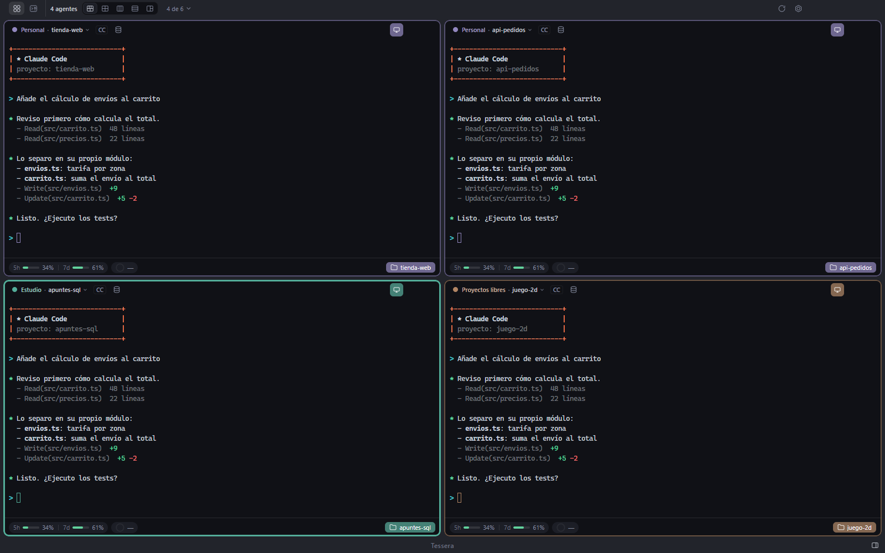

Todos los agentes que trabajan, en una rejilla de hasta seis casillas, para seguir varios
proyectos a la vez. Salta a una casilla, amplíala, y sal del mosaico con el mismo atajo con
el que entraste.

### Editor y visores

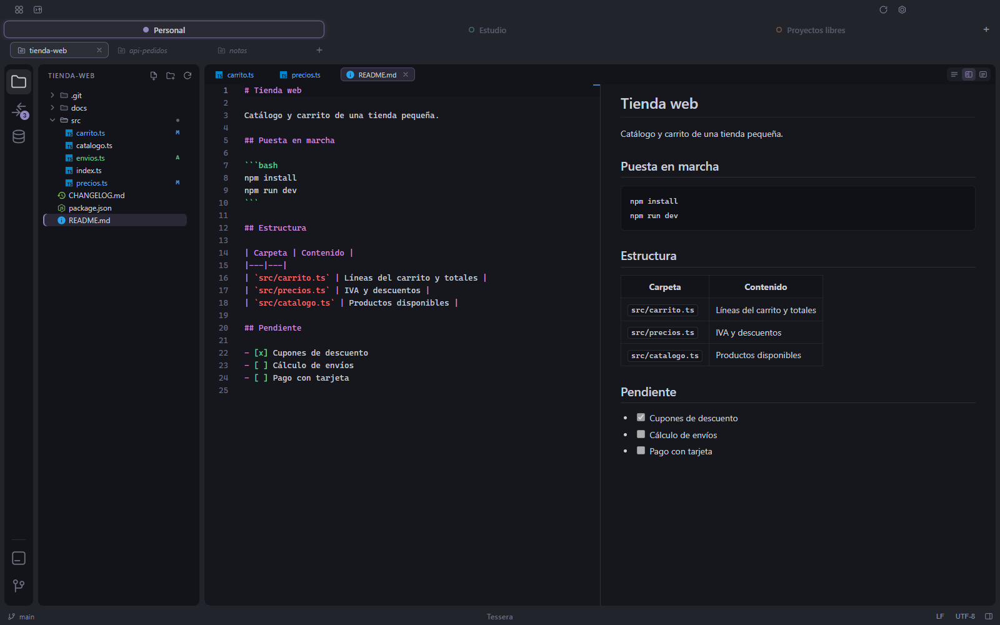

- Editor **Monaco** con resaltado de sintaxis para muchos lenguajes, buscar y reemplazar, y
  pestañas por proyecto.
- Detecta la **codificación y el fin de línea** de cada archivo, los enseña en la barra de
  estado y te deja convertirlos.
- **Markdown** con vista renderizada (diagramas Mermaid incluidos), vista de código, o las
  dos lado a lado con el scroll sincronizado. Los HTML tienen una vista previa aislada.
- **Visores** de PDF, Word (`.docx`), archivos ZIP, imágenes (con zoom), y audio y vídeo
  (`.mp4`, `.webm`, `.mp3`, `.wav` y similares) sin instalar nada.
- **Archivos de Java**: los `.jar`, `.war`, `.ear` y `.aar` se abren en el explorador como
  carpetas, y los `.class` se descompilan al vuelo. Comparar dos versiones de un archivo
  enseña qué entradas cambiaron y el diff de las clases descompiladas.

### Explorador de archivos

- Selección múltiple con Ctrl/⌘-clic y Mayús-clic, arrastrar y soltar para mover, crear,
  renombrar y borrar.
- Copia y pega archivos entre Tessera y el Explorador o el Finder por el portapapeles del
  sistema.
- **Buscar en archivos** en todo el proyecto o en una carpeta, con vista previa en vivo.
- Colores de estado de Git en archivos y carpetas, al día según cambian en disco.
- **«Abrir con Tessera»** desde el menú del clic derecho del Explorador de Windows (carpetas,
  cualquier archivo o extensiones asociadas, cada uno se activa por separado en
  Configuración); en macOS, una acción rápida del Finder para carpetas más «Abrir con»
  para archivos de código y de texto, y en Linux, Tessera en el «Abrir con» de las carpetas
  de tu gestor de archivos y en el lanzador de aplicaciones. Tessera nunca se convierte en la
  app por defecto de un tipo de archivo.

### Git

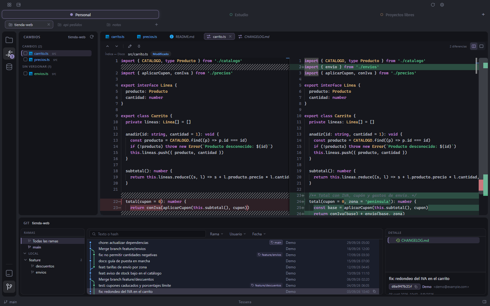

- **Cambios**: el árbol de trabajo como lista o como árbol, preparar y quitar del índice,
  descartar, ignorar (en `.gitignore` o solo en local) y hacer commit.
- **Historial** con su grafo de ramas, filtros, el detalle de cada commit y el historial de
  un solo archivo.
- **Diffs editables**: corrige algo directamente en el diff de tu copia de trabajo.
- **Varios repositorios** en una misma carpeta de proyecto, también agrupados en subcarpetas
  por área o por capa (hasta cuatro niveles): Cambios enseña solo los que tienen cambios, cada
  uno con una casilla para marcarlo entero, y eliges cuál enseña el historial.

### Terminales

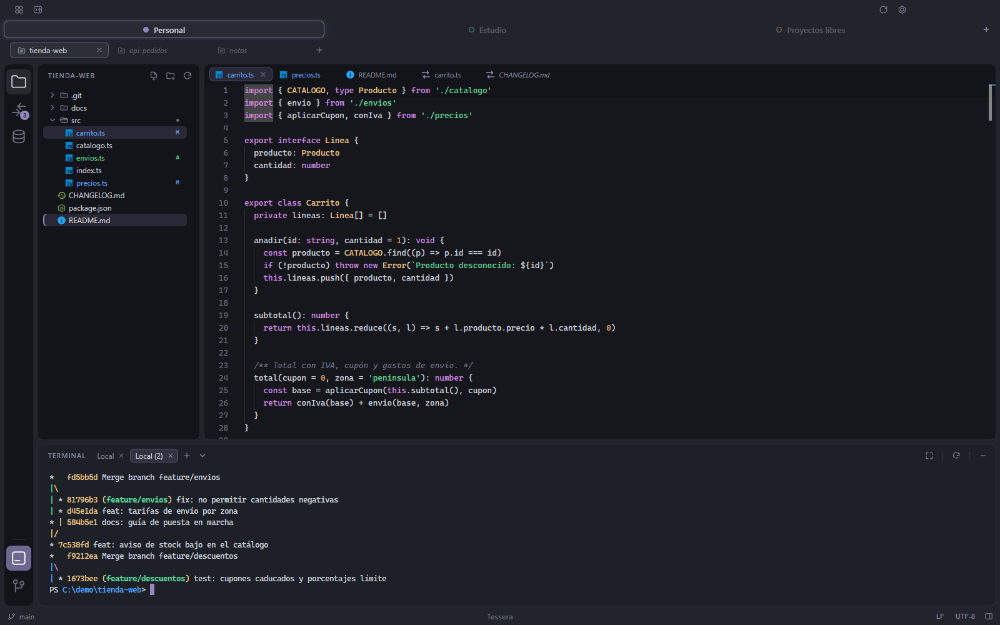

- Un panel de terminal en la parte inferior de la ventana para el proyecto activo, con
  varias terminales en pestañas, siempre nativas: tu propia shell (PowerShell en Windows, tu
  shell de inicio de sesión en macOS y en Linux).
- Buscar en el historial de la terminal, copiar y pegar como espera cada plataforma, y
  renderizado acelerado por GPU que puedes apagar en Configuración.
- **Logs con color**: lo que llega sin color se resalta (errores, avisos, fechas, IPs, URLs y
  códigos HTTP) en los formatos de log habituales, también por SSH, sin cambiar el texto que
  copias. Se apaga en Configuración.
- **Pantalla completa**: la terminal ocupa todo el área de trabajo con un botón o con
  Ctrl+Shift+Enter (⇧⌘↩), sin cerrar nada de lo que tapa.
- **Agente de la terminal**: a pantalla completa, un agente propio del espacio de trabajo a
  la derecha de la terminal, con su carpeta y su historial, para pedir ayuda con tus
  servidores sin abrir un proyecto. Salir de pantalla completa lo oculta sin cerrarlo.

### Conexiones SSH

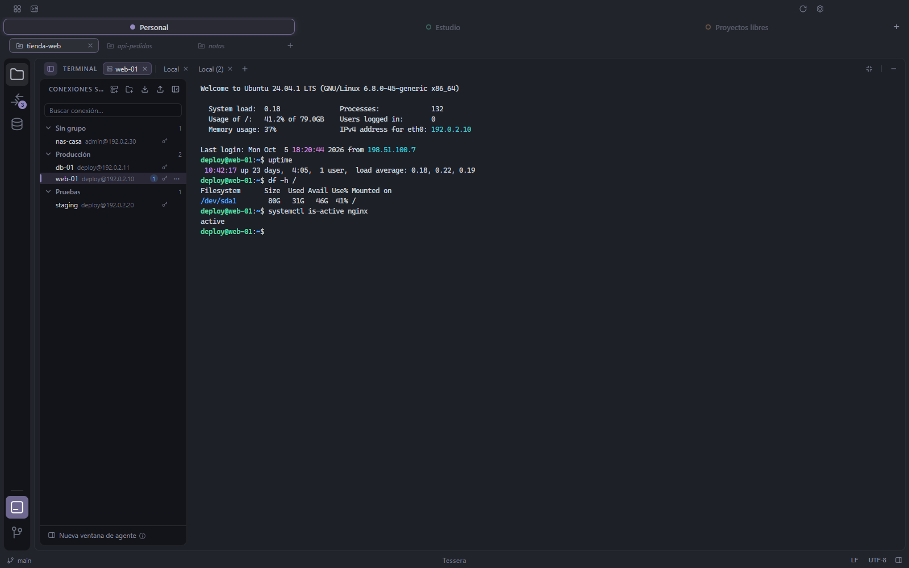

- **Las conexiones SSH de cada espacio de trabajo**, con nombre y en grupos, se abren en
  pestañas de la terminal que se ven en todos sus proyectos, también sin proyecto abierto. A
  pantalla completa quedan fijas en un riel a la izquierda; si no, en la ▾ de la terminal.
- **Tres formas de entrar**: contraseña, archivo de clave (`.pem` u OpenSSH, que Tessera
  guarda como copia protegida sin tocar el original) o las claves del sistema (el agente de
  claves y tu carpeta `.ssh`). La contraseña y la frase de la clave se guardan cifradas y se
  dan solas al conectar; si el servidor las rechaza, o pide un segundo factor, Tessera lo
  pregunta en un diálogo. «Probar» comprueba la conexión antes de guardarla.

  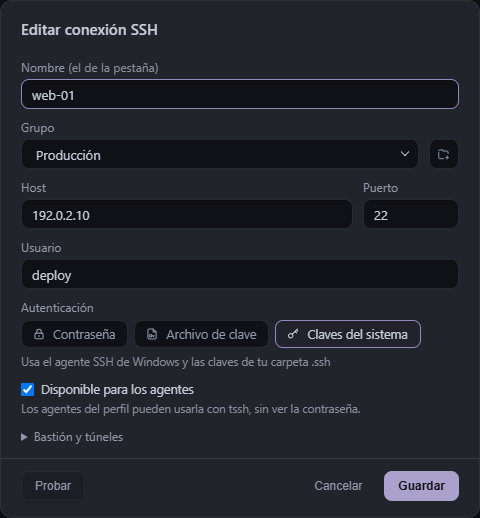

- **Bastiones y túneles**: una conexión puede saltar por otra del espacio de trabajo para
  llegar a un equipo que no se ve directamente (hasta cuatro saltos), y abrir túneles locales,
  remotos y SOCKS que viven lo que vive su terminal. La terminal, el explorador SFTP y los
  agentes atraviesan el bastión igual.
- **Las sesiones se reconectan** desde la propia terminal (Intro o «Reconectar») cuando se
  cortan, y las pestañas SSH abiertas vuelven al abrir Tessera, sin conectarse hasta que las
  miras.
- **Importar desde OpenSSH**: lee tu `~/.ssh/config` (o el archivo que elijas). Con un solo
  `Host` rellena el formulario; con varios, abre una revisión para elegir cuáles importar,
  cambiarles el nombre, el usuario y el grupo de cada una, y dejar la contraseña o la clave.
- **Exportar a OpenSSH**: guarda las conexiones del espacio (o las que marques) en un `config`
  de OpenSSH, con sus bastiones, túneles y una copia protegida de sus claves.
- **Organízalas a tu manera**: grupos, varias a la vez con Ctrl/⌘-clic y Mayús-clic,
  arrastrarlas de un grupo a otro, y «Duplicar» para crear una copia con todo.
- **Explorador SFTP** de cada conexión en una pestaña: navegar, crear carpetas, renombrar,
  borrar, y subir y bajar archivos y carpetas (también soltándolos encima) con progreso,
  cancelación y confirmación antes de reemplazar.
- **`tssh` para los agentes.** El agente de cualquier proyecto del espacio de trabajo, nativo
  o Docker, y el agente de la terminal pueden listar las conexiones, ejecutar comandos y
  copiar archivos con un CLI pequeño, `tssh`, por el nombre de la conexión. Nunca ven la
  contraseña ni la clave, y solo entran en servidores cuya huella ya aceptaste tú. La casilla
  «Disponible para los agentes» de cada conexión decide si la ven, y cada petición queda
  apuntada en `logs/ssh.log` (con qué conexión y cómo acabó, nunca la orden).

### Bases de datos

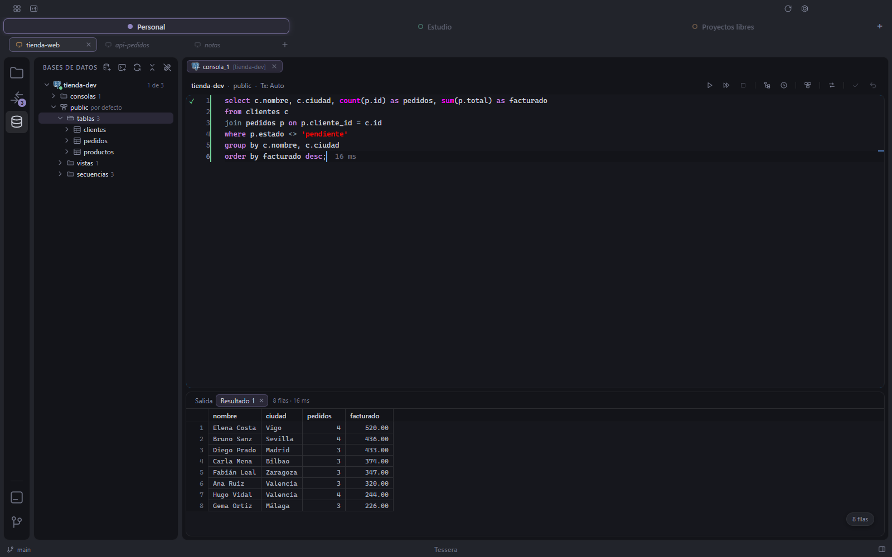

- **Oracle, PostgreSQL, SQL Server, MySQL, MariaDB, MongoDB, Redis y SQLite**, en una vista
  **Conexiones** propia, organizada por espacio de trabajo. Redis también con Sentinel (sigue
  al maestro nuevo tras un failover) y con Cluster.
- **Conexiones cifradas** (SSL/TLS, y TCPS en Oracle) con el certificado verificado contra
  las autoridades de confianza de tu equipo, y **por un túnel SSH** a través de una de tus
  conexiones SSH, también con bastión. Pegar una URI (`postgres://`, `mysql://`,
  `mongodb://`…) rellena el formulario.
- Un árbol de esquemas y objetos, una rejilla de resultados con paginado y exportación,
  consolas SQL con autocompletado, formato, planes de ejecución e historial de consultas, y
  consolas para MongoDB y Redis con su propia sintaxis.
- **Edición con confirmación**: los cambios de la rejilla o de una consola esperan a que los
  envíes, todo o nada. Las conexiones se pueden marcar como desarrollo, pruebas o producción,
  y producción pregunta antes de escribir. Tessera avisa; nunca te bloquea.
- **La solo lectura es para los agentes.** Marcar una conexión de solo lectura limita lo que
  los agentes pueden hacer con ella; a ti nunca te limita.
- **`tdb` para los agentes.** Monta una conexión en un proyecto y el agente puede
  consultarla con un CLI pequeño, `tdb`, por el nombre de la conexión. El agente nunca ve la
  contraseña.
- Oracle funciona de entrada en modo thin. Los servidores antiguos que necesitan el modo
  thick usan Oracle Instant Client, que Tessera puede descargar por ti desde oracle.com, o
  puedes indicarle uno que ya tengas.
- Las contraseñas se cifran con el almacén de secretos del sistema (DPAPI en Windows, el
  Llavero en macOS, GNOME Keyring o KWallet en Linux).

### Configuración

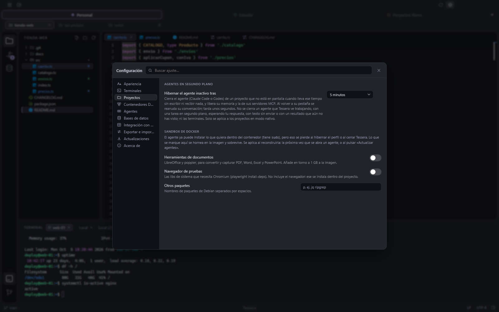

Una ventana de configuración con buscador (Ctrl+, / ⌘,): apariencia, zoom e idioma (español
o inglés), fuentes de las terminales, la hibernación de
los agentes, la imagen del sandbox, los valores por defecto de bases de datos, la integración
con el sistema, las actualizaciones y una página «Acerca de».

**Exportar e importar** lleva tu configuración a otro equipo (Windows, macOS o Linux): los
espacios de trabajo que elijas con sus conexiones SSH y de bases de datos, tus agentes y tus
preferencias, en un archivo `.tessera` cifrado con una frase. Al importar eliges qué entra, y
no se toca lo que ya tenías.

### Actualizaciones automáticas

Tessera consulta su canal de versiones en GitHub, descarga las nuevas en segundo plano y
las aplica al cerrar la app, en Windows, en macOS y en Linux.

## Atajos de teclado

El modificador principal es Ctrl en Windows y Linux y ⌘ en macOS. Algunos gestos usan una
tecla distinta en cada plataforma, siguiendo las convenciones de cada sistema.

| Acción | Windows y Linux | macOS |
| --- | --- | --- |
| Configuración | Ctrl+, | ⌘, |
| Buscar en archivos | Ctrl+Shift+F | ⇧⌘F |
| Archivo nuevo (consola nueva en Conexiones) | Ctrl+N | ⌘N |
| Mostrar u ocultar el panel de terminal | Ctrl+` | ⌃` |
| Acercar / alejar / restablecer el zoom | Ctrl+= / Ctrl+- / Ctrl+0 | ⌘= / ⌘- / ⌘0 |
| Entrar o salir del mosaico de agentes | Ctrl+Shift+M | ⇧⌘M |
| Enfocar la casilla 1 a 6 del mosaico | Ctrl+1 … Ctrl+6 | ⌘1 … ⌘6 |
| Ampliar o restaurar la casilla enfocada | Ctrl+Shift+Enter | ⇧⌘↩ |
| Pantalla completa del panel inferior (con el foco en la terminal o en Git·Log) | Ctrl+Shift+Enter | ⇧⌘↩ |
| Buscar en una terminal | Ctrl+F | ⌘F |
| Copiar en una terminal (con selección) | Ctrl+C | ⌘C |
| Pegar en una terminal | Ctrl+V | ⌘V |
| Abrir el elemento seleccionado (explorador, árbol de bases de datos) | F4 o Enter | F4, ⌘↓ o Enter |
| Borrar los archivos seleccionados | Supr | ⌘⌫ o Supr |

Con el foco en una terminal, Ctrl+N en Windows y Linux es de la shell (le llega como ^N) y no
crea un archivo; en macOS ⌘N no es una tecla de control y crea el archivo igual.

En la vista **Conexiones**:

| Acción | Windows y Linux | macOS |
| --- | --- | --- |
| Ejecutar la sentencia actual | Ctrl+Enter | ⌘↩ |
| Ejecutar toda la consola | Alt+X o Ctrl+Shift+Enter | ⌥X o ⇧⌘↩ |
| Detener | Ctrl+F2 | ⌘. |
| Commit | Ctrl+Alt+Shift+K | ⌥⇧⌘K |
| Rollback | Ctrl+Alt+Shift+R | ⌥⇧⌘R |
| Plan de ejecución | Ctrl+Shift+E | ⇧⌘E |
| Historial de consultas | Ctrl+Shift+H | ⇧⌘H |
| Formatear el SQL | Ctrl+Alt+L | ⌥⌘L |
| Cerrar la pestaña | Ctrl+W | ⌘W |
| Mostrar u ocultar el agente | Ctrl+Alt+B | ⌥⌘B |

## Dónde se guardan tus datos

| Plataforma | Carpeta |
| --- | --- |
| Windows | `%APPDATA%\Tessera` |
| macOS | `~/Library/Application Support/Tessera` |
| Linux | `~/.config/Tessera` |

En esa carpeta están tus espacios de trabajo, las pestañas abiertas, la configuración, las
sesiones de los agentes en Docker, las conexiones a bases de datos (con las
contraseñas cifradas), las conexiones SSH (con las contraseñas cifradas, las copias
protegidas de sus claves y las huellas de cada servidor), las consolas guardadas, Oracle Instant Client si lo descargaste y los
registros. Las escrituras resisten un cierre inesperado, con una copia de respaldo de
cada archivo.

**Tus proyectos nunca se copian.** Tessera los abre donde están; para los agentes en Docker monta
las carpetas de los proyectos en el contenedor del espacio de trabajo. El desinstalador de
Windows pregunta si conservar o borrar tus datos, y una actualización nunca los toca.

## Privacidad

- **Qué ve un agente.** Un agente en Docker ve solo los proyectos de su espacio de trabajo,
  sus propias credenciales y, en solo lectura, tus llaves SSH. Un agente nativo corre como tú
  en tu equipo, igual que en cualquier terminal.
- **Sin telemetría.** Tessera no tiene analítica, ni servicio de informes de fallos, ni
  seguimiento de uso. Los registros se escriben solo en la carpeta de datos de arriba.
- **Conexiones de red que hace Tessera por su cuenta:**
  - el canal de actualizaciones en GitHub (`github.com/NRVH/tessera/releases`);
  - el uso de la cuenta que enseña el pie del agente, leído de la API de Anthropic con el
    propio token de esa cuenta (el de Codex se lee de archivos locales);
  - la comprobación de versiones nuevas de los agentes contra el registro de npm, el canal
    de versiones de Claude Code y, en macOS, Homebrew;
  - cuando lo pides, la descarga de Oracle Instant Client desde oracle.com;
  - al construir la imagen del sandbox, Docker descarga la imagen base y los paquetes de sus
    registros públicos.
- **Lo que cada agente hace con su proveedor** (Anthropic en Claude Code, OpenAI en Codex)
  lo rigen ese proveedor y tu cuenta, no Tessera.
- **Las contraseñas de bases de datos** se guardan cifradas con el almacén de secretos del
  sistema, y los agentes llegan a las bases por `tdb` sin recibirlas.
- **Las contraseñas y las claves SSH** siguen el mismo camino: cifradas con el almacén de
  secretos del sistema, nunca en el entorno ni en los registros, y los agentes entran en los
  servidores por `tssh` sin recibirlas.

## Compilar desde el código

Necesitas **Node.js 22.18 o posterior** (el flujo de publicación usa el último Node 22) y
**Git**. Para los agentes en Docker, también Docker.

```bash
git clone https://github.com/NRVH/tessera.git
cd tessera
npm ci
npm run dev
```

`npm run dev` descarga el binario de Electron la primera vez y abre la app con recarga en
caliente. La instancia de desarrollo guarda sus datos en una carpeta aparte, `Tessera-dev`,
así que nunca toca una copia instalada.

Para generar el instalador de tu propia plataforma:

```bash
npm run release:win   # Windows: dist/Tessera-<versión>-Setup.exe
npm run release:mac   # macOS:   dist/Tessera-<versión>-arm64.dmg (y el .zip que usan las actualizaciones)
npm run release:linux # Linux:   dist/Tessera-linux-x86_64.AppImage
```

electron-builder no compila de un sistema a otro, así que cada plataforma se compila en esa
plataforma. En macOS la app se firma ad-hoc sola: no necesitas una cuenta de desarrollador
de Apple.

| Comando | Qué hace |
| --- | --- |
| `npm run dev` | Arranca la app en modo desarrollo con recarga en caliente |
| `npm run build` | Comprueba los tipos y compila en `out/` |
| `npm run pack:dir` / `npm run pack:mac:dir` / `npm run pack:linux:dir` | Empaqueta sin instalador (`dist/win-unpacked`, `dist/mac-arm64`, `dist/linux-unpacked`) |
| `npm run release:win` / `npm run release:mac` / `npm run release:linux` | Genera el instalador de la plataforma actual, sin publicar |
| `npm run typecheck` | Comprueba los tipos del proceso principal, de la interfaz y de la suite e2e |
| `npm run lint` | ESLint sobre todo el repositorio |
| `npm run test:<nombre>` | Ejecuta un script de prueba (ver `package.json`) |
| `npm run test:e2e` | Ejecuta la suite de Playwright contra la app empaquetada |

## Arquitectura

```
            ┌──────────── Tessera (equipo) ──────────┐
            │  editor · explorador · Git · ajustes   │
            └───────┬───────────────┬────────────────┘
                    │ IPC           │ IPC
          ┌─────────▼──────┐  ┌─────▼──────────┐
          │ espacio A      │  │ espacio B      │   un contenedor cada uno
          │ /workspace/…   │  │ /workspace/…   │   solo sus proyectos
          │ /agent-config  │  │ /agent-config  │   su cuenta, montada solo
          │ claude · codex │  │ claude · codex │   mientras el agente corre
          └────────────────┘  └────────────────┘
```

- Electron, TypeScript y React, con electron-vite. Monaco para el editor, xterm.js y
  node-pty para las terminales, el binario `git` del sistema para Git, el cliente OpenSSH
  del sistema para SSH y SFTP, y Docker para el sandbox.
- El editor, el explorador y Git corren en tu equipo (son tus herramientas); los agentes
  corren en tu equipo o, si eliges una cuenta de Docker, en el contenedor del espacio de
  trabajo; la terminal de abajo es siempre nativa.
- La interfaz corre con `contextIsolation` y `sandbox` activados y solo habla con el proceso
  principal por IPC tipado. Dos reglas lo atraviesan todo:
  - **La interfaz nunca ve ni envía rutas del equipo.** Todo viaja como rutas relativas a la
    carpeta del proyecto, y el proceso principal las traduce.
  - **Cada canal IPC se declara** en `src/shared/*-ipc.ts`, con sus tipos de petición y de
    respuesta, y se expone por `src/preload/`.
- La imagen del sandbox se construye desde [`docker/sandbox/`](./docker/sandbox/).

```
src/
  main/       proceso principal de Electron: sandbox, agentes, Git, archivos, bases de datos, actualizaciones
  preload/    el puente tipado que se expone a la interfaz
  renderer/   interfaz en React, organizada por funciones
  shared/     contratos IPC y lógica pura que usan los dos lados
  tdb/        el CLI de bases de datos que usan los agentes
  tssh/       el CLI de conexiones SSH que usan los agentes
  askpass/    el ayudante que da la contraseña guardada al cliente OpenSSH
docker/       la imagen del sandbox
e2e/          suite de Playwright contra la app empaquetada
```

El estándar de código está en [`docs/ESTANDAR_CODIGO.md`](./docs/ESTANDAR_CODIGO.md) y las
decisiones de diseño, en [`docs/decisiones/`](./docs/decisiones/README.md).

## Pruebas

```bash
npm run typecheck
npm run lint
npm run test:<nombre>                 # un script de prueba
node scripts/pruebas/bateria.mjs git  # todos los test:* cuyo nombre case con una regex, uno tras otro
npm run test:e2e                      # Playwright contra la app EMPAQUETADA
```

- Las pruebas unitarias son archivos `test-*.mts` junto al módulo que prueban, y corren con
  `node` a secas (type-stripping nativo). No hay framework de pruebas ni un `npm test` que
  las agrupe; cada una tiene su script `test:<nombre>`, y unas treinta necesitan Docker
  levantado.
- `test:cabeceras`, `test:comentarios` y `test:menciones` comprueban el estándar de código.
- La suite de extremo a extremo conduce la app empaquetada (`dist/win-unpacked`,
  `dist/mac-arm64/Tessera.app` o `dist/linux-unpacked`), así que hay que reconstruirla con
  `npm run pack:dir`, `npm run pack:mac:dir` o `npm run pack:linux:dir` después de cambiar
  código de la aplicación.

## Contribuir

Los issues y los pull requests son bienvenidos, en español o en inglés. Lee antes
[CONTRIBUTING.md](./CONTRIBUTING.md): el código está escrito en español, y Windows, macOS y
Linux son plataformas de primera clase las tres. Las vulnerabilidades se reportan en privado como explica
[SECURITY.md](./SECURITY.md). Se espera que todo el que participe siga el
[Código de conducta](./CODE_OF_CONDUCT.md).

## Licencia

[MIT](./LICENSE) © 2026 Noé Roberto Vázquez Herrera.

Tessera incluye software de terceros con sus propias licencias; ver
[THIRD_PARTY_NOTICES.md](./THIRD_PARTY_NOTICES.md).

## Autor

Hecho por **Noé Roberto Vázquez Herrera** · [GitHub](https://github.com/NRVH) ·
[LinkedIn](https://www.linkedin.com/in/noe-vazquez-03863423a/)

Si Tessera te sirve y quieres apoyar su desarrollo, puedes hacerlo por
**[PayPal](https://paypal.me/NoeRvH)**. ¡Gracias!
